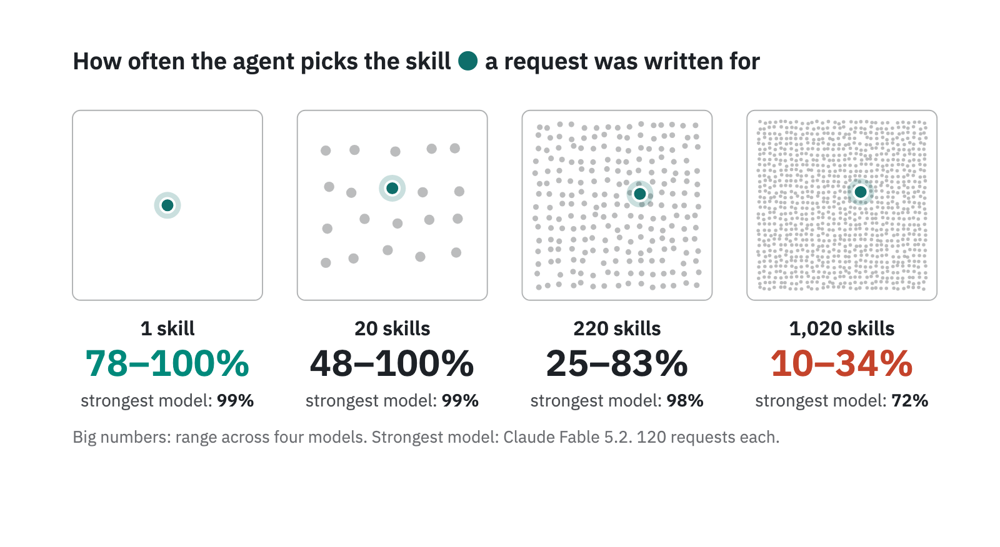
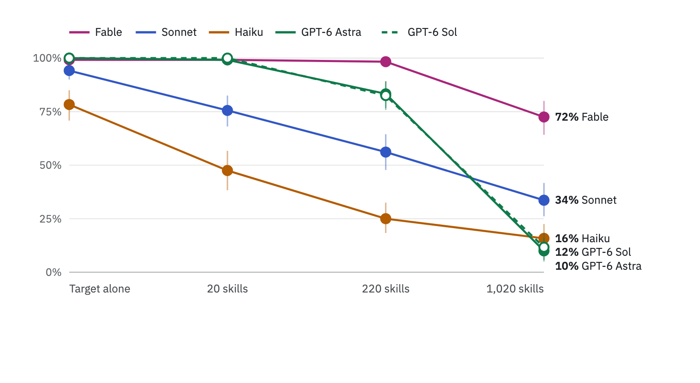
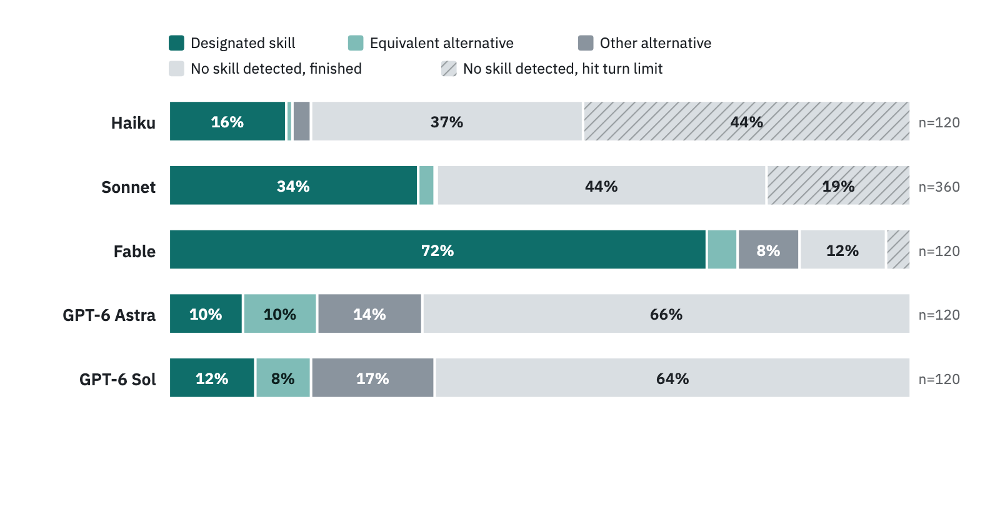

<!-- A readable copy of the post, made by post/build_md.py. To suggest changes, edit this file in a pull request;
     they are carried over into post/build_post.py, which builds the page. Numbers, tables and charts come from
     the data, so if you think one is wrong, say so in the PR rather than changing the number. -->



AI Agents · Claude Code · Codex · Agent Skills · MCP

# A Closet Full of Skills and Nothing to Wear: The More Skills You Install, the Less Often Your Agent Picks the Right One (MCP Tools Hold Up Better)

*I installed up to 1,000 skills and ~800 MCP tools in Claude Code and Codex, and measured how often the agent still picked the one each request was written for.*

Galina Alperovich · November 2026

The experiment, data and analysis: [github.com/galinaalperovich/closet-full-of-skills](https://github.com/galinaalperovich/closet-full-of-skills). Every request, every result record and every script, so you can reproduce all the numbers for free.

A skill to check your own agent: coming soon

tldr; Installing a skill doesn’t mean your agent will use it. I sent 120 natural requests to Claude Code and Codex, each written for one particular skill, and kept installing more skills around it. What I found:

1. **Skills fade.** With only that skill installed, the agent picked it in 78–100% of runs. With 1,000 other skills next to it, in only 10–34%.
2. **Twenty is enough.** With just 20 unrelated skills, and nothing cut from the listing, Haiku already lost 31 points and Sonnet 19.
3. **Past a few hundred skills, the harness quietly cuts the listing.** Codex listed only 321 skills, in alphabetical order, and dropped the rest. Claude Code kept every name but only 19 descriptions, and your usage history decides which.
4. **Most misses are no skill at all, not a wrong one.** The agent carries on with its built-in tools, and nothing tells you.
5. **MCP tools held up better.** In Claude Code, single-step tool selection went from 84–88% with the tool alone to 77–80% with all 791 tools installed, and stayed flat from ~200 tools on.

The experiment has [its limits](#limitations-of-the-experiment), and they limit how far the result generalizes. At the end I share [a few tricks for dealing with it](#what-you-can-do-about-it).

<!-- The table of contents is made from the headings. -->

Agent skills became **the new npm**. A skill is a folder with a `SKILL.md` file: a name, a short description, and instructions the agent reads only when it needs them. The biggest community collection I found, [sickn33/agentic-awesome-skills](https://github.com/sickn33/agentic-awesome-skills), has over 3,000 skills, and its README invites you to install all of them. MCP servers went the same way: one GitHub server alone exposes 149 tools.

Here is what made me curious. The agent chooses a skill from its description, and the descriptions in that one collection add up to about 129K tokens. *The Great Gatsby* is about 72K. No harness sends **two Gatsbys** with every request: Claude Code and Codex both cap the listing. So what happens to the skills that do not fit, and to the ones that do?

If this sounds like the **needle-in-a-haystack test**, it is a harder version of it. The [original test](https://github.com/gkamradt/LLMTest_NeedleInAHaystack) hides one fact in a long document and asks for it directly. Here the needle is one skill or tool among hundreds, and nobody asks for it: the model has to notice on its own that the request needs it. Benchmarks come close. [MetaTool](https://arxiv.org/abs/2310.03128) tests whether a model knows it needs a tool and which one, and [LongFuncEval](https://arxiv.org/abs/2505.10570) and [Liu et al.](https://arxiv.org/abs/2604.04323) show tool calling and skill use degrading as catalogs grow. What I did differently:

- **Real harnesses, not a bare model.** Claude Code and Codex as you run them, with their own listing budgets, prompts and tool search. What the harness does before the model sees anything turned out to matter most.
- **Real skills and tools:** 20 popular skills and 20 published MCP tools, among up to 1,000 real skills and 791 real tool definitions.
- **Requests that never name the skill**, sent unchanged to every setup, so each change compares the same requests.
- **Skills and MCP tools side by side, then mixed.**
- **What the model actually received:** I captured the listing each harness sent, and it explains most of the drop.

## Why this is a problem

- **A skipped skill fails silently.** Nothing breaks, and until you read the traces and logs, you won’t know the skill or tool was never picked. The agent answers anyway, and LLMs are very good at answers that look as if the skill was used, while your instructions were never read and your data was never touched. Ask for Apple’s stock price without the finance tool being called, and you may get **a confident number from the model’s memory**.
- **One skipped skill can skip a whole recipe.** A skill often says which tools to call and in which order: run the linter, then the tests, then open the pull request. Skip the skill, and nothing makes sure those steps happen.
- **If you have rules to follow, it gets worse.** Some projects must follow a fixed process or use specific data: a legal review, an approved template, the official price list. How do you prove to an auditor that your agent did not improvise? “We installed the skill and hoped for the best” is not an audit trail. We need to measure, and be able to prove, that the agent uses what it is supposed to use.
- **It takes an everyday setup, not an extreme one.** [One Claude Code issue](https://github.com/anthropics/claude-code/issues/81081) reports that 75% of project skills (27 of 36) reached the model with only a name, and [one user counted](https://github.com/anthropics/claude-code/issues/11364) 67,300 tokens of tool definitions from seven MCP servers before the first message. More reports are in the references.

## How an agent picks a skill or a tool

A **skill** is a folder of instructions that teaches the agent *how* to do something. An **MCP tool** is a function on a server that *does* one thing, such as creating an issue, and returns a result.

**Loading a skill is itself a tool call.** Claude Code calls its `Skill` tool; Codex reads the file with a shell command such as `cat .agents/skills/pdf/SKILL.md`. The call returns the instructions, and the work happens in the calls that follow. That first call is what I count as “selected” (for Codex, a command naming the skill’s `SKILL.md`; I did not check that the read succeeded).

The two also reach the model differently. Skills sit in one listing of names and descriptions, sent with every request. Claude Code lists MCP tools by name only and fetches a full definition on demand, with a `ToolSearch` call.


*Figure 1. How a request reaches a skill or a tool, with MCP tools handled the way Claude Code does it.*

Between installing a skill and the skill doing its job there are four stages:

1. **Installed.** The skill folder or MCP server is on disk and enabled.
2. **Listed.** The harness fits names and descriptions into a budget: [1% of the context window in Claude Code, which drops descriptions when it overflows](https://code.claude.com/docs/en/skills.md), and [2%, at most 10,000 tokens, in Codex, which shortens them first](https://learn.chatgpt.com/docs/build-skills). **Checked afterwards.**
3. **Selected.** The model loads the skill or calls the tool. **Measured here.**
4. **Used.** The instructions are followed and the task gets done. Not measured.

## The experiment setup


*Figure 2. The same request in four setups, from the target alone to 1,000 other skills (or 791 tools).*

I picked 20 well-known skills ([Anthropic’s](https://github.com/anthropics/skills) pdf, xlsx, pptx and docx, [Matt Pocock’s](https://github.com/mattpocock/skills) tdd and grill-me, and others; full list in [Appendix A](#appendix-a)) and 20 everyday MCP tools out of 791 real tool definitions from 73 servers ([GitHub](https://github.com/github/github-mcp-server), [Chrome DevTools](https://github.com/ChromeDevTools/chrome-devtools-mcp), [Playwright](https://github.com/microsoft/playwright-mcp), and 70 servers from [LiveMCPBench](https://github.com/icip-cas/LiveMCPBench)).

For each target an LLM wrote six realistic requests with no explicit invocation: no `/pdf`, no “use the pdf skill”. [All requests are in the repo.](https://github.com/galinaalperovich/closet-full-of-skills/blob/main/prompts.json)

*Table 1. Example requests. Every target had six like these.*

| Target | Example requests |
|---|---|
| `pdf` skill | “Merge invoice-jan.pdf and invoice-feb.pdf in this folder into a single file.” |
| `seo-audit` skill | “Why did our organic traffic drop last month?” |
| `grill-me` skill | “Grill me on this plan before I start building.” |
| `github.create_issue` tool | “Open an issue in acme/webapp saying the login button is broken on Safari.” |

Each request ran in four setups:

1. **Alone:** only the target, plus what the harness ships: 23 built-in skills in Claude Code, and 5 in Codex, such as `skill-creator`, which I left on.
2. **20:** all 20 targets together.
3. **~220:** the 20 plus 200 others, drawn at random.
4. **All:** the 20 plus 1,000 other skills, or all 771 other tools.

Three configurations ran them: Claude Haiku and Claude Sonnet in Claude Code (v2.1.328), and GPT-6 Astra (medium reasoning) in Codex CLI (v0.160.0). Each is a model plus a harness with its own system prompt, listing budget and permissions, so when Codex behaves differently from Claude Code, I can’t tell how much of it is the model and how much the harness.

Four details matter for reading the numbers:

1. **Fake skill bodies.** Each skill keeps its real name and description, which is all the agent sees when it chooses, but its instructions are one line: “reply with one short sentence”. MCP tools likewise have real definitions and a canned reply. This kept thousands of runs cheap and identical: the choice is realistic, and everything after it is not.
2. **Fresh, empty folders.** Empty, so every setup sees exactly the same thing, though a request about `report.pdf` then finds no such file (Result 3 shows what agents did about it). Fresh, because Claude Code keeps a memory per folder: in my first pass, runs shared a folder, and notes saved in one run were loaded by the next. In one folder, five runs started with such a note, and all five missed the skill. I reran every affected run, with a little less enthusiasm than the first time.
3. **Short observation window.** Claude Code was capped at 3 turns (4 with MCP). Picking a skill is the agent’s first decision, almost always made in the first turn or two, and the cap kept thousands of runs fast, at the price of missing later picks. Codex has no turn cap: a run is one user message, within which the model takes as many steps as it wants.
4. **Scoring.** A skill request is a hit only if the agent picks exactly the skill the request was written for; a tool request also counts an equivalent tool on another server. When the agent picked something else, a separate Claude session later judged from the two descriptions whether it was just as good: a model’s judgment, not a human’s ([prompt and rules](https://github.com/galinaalperovich/closet-full-of-skills/blob/main/analysis/alt_judge_prompt.md)). 13 alternatives in the Claude Code MCP and mixed runs were never judged and count as misses.

**How to read the numbers.** Each configuration got 120 skill requests and 90 single-step tool requests. Brackets are 95% confidence intervals from resampling requests, and changes compare the same requests, in percentage points. They do not cover the random draw of extra skills or the request wording; the details are in the [methodology](https://github.com/galinaalperovich/closet-full-of-skills/blob/main/METHODOLOGY.md).

## Result 1: Skills fade

*Table 2. Share of requests where the agent picked the designated skill, with 95% CIs.*

| Setup | Skills | Haiku (Claude Code) | Sonnet (Claude Code) | GPT-6 Astra (Codex) |
|---|---|---|---|---|
| Target skill alone | 1 | 78% [71–85] | 94% [90–98] | 100% [97–100] |
| 20 skills together | 20 | 48% [38–57] | 76% [68–82] | 99% [98–100] |
| Plus 200 others | 220 | 25% [18–32] | 56% [48–64] | 83% [77–89] |
| Plus 1,000 others | 1,020 | 16% [9–22] | 34% [26–42] | 10% [5–16] |



*Figure 3. The same numbers as a chart. Sonnet: 360 runs per point; Haiku and GPT-6 Astra: 120. The x axis is not to scale.*

**The decline is already there at 20.** These are 20 skills about different things: PDFs, SEO, TDD, animation. On the same requests, Haiku lost 31 points and Sonnet 19, and almost no request got better. I expected trouble at a thousand skills. I did not expect it at twenty, but **twenty is enough**.

### What the model actually saw

Was the listing cut, or did the model choose badly from a full one? I re-ran every skills setup against a stand-in server that records what each harness sends to the model: same versions, commands and folders, no model called, no cost ([scripts and results](https://github.com/galinaalperovich/closet-full-of-skills/tree/main/listing)).

*Table 3. What the skill listing contained in each setup. Haiku and Sonnet received the same listing.*

| Setup | Claude Code | Codex |
|---|---|---|
| Alone | the target, with its full description | the target, with its full description |
| 20 skills | all 37 entries, full descriptions | all 24 entries, full descriptions |
| ~220 skills | 237 names, only 100 with a description | all 224, each description cut to about 30 characters |
| 1,020 skills | 1,037 names, only 19 with a description | only 321 entries, in alphabetical order, names only: 3 of the 20 targets |

- **At 20 skills, nothing was cut.** Both harnesses showed every description in full, so the drop at 20 is the model’s own choice.
- **GPT-6 Astra’s cliff is the alphabet.** At 1,020 skills, Codex listed only 321 entries: its own 4 skills, then the installed ones in alphabetical order up to “developer-listening”, with no descriptions at all. Of the 20 targets, only `animate`, `caveman` and `copywriting` made it in, and they account for 11 of GPT-6 Astra’s 12 hits. Every other skill it picked starts early in the alphabet. If your skill is called `zebra-something`, I have bad news.
- **Claude Code keeps the names, drops the descriptions, and your history decides which survive.** Its listing stops growing at about 30,000 characters, so at 1,020 skills only 19 entries kept a description. Claude Code records how often and how recently you used each skill, across all your projects, and the most-used keep their descriptions. With a clean record, none of the 20 targets had a description at 1,020; after I seeded the record with uses of `seo-audit` and `pdf`, exactly those two got theirs back.

That last point has a twist, and this one is on me: my own runs fed that record, so a skill picked in one run was more likely to keep its description in the next. I captured the listings after the study, so I cannot say exactly which targets had a description in each run, only that at 1,020 skills almost none did. **A new skill in a big collection starts life as a bare name.**

### When the designated skill was not picked, what did the agent do instead?

A miss can mean three different things:

1. The agent picked another skill, sometimes an equally good one.
2. It picked no skill and carried on with its built-in tools.
3. It ran out of turns before choosing anything.



*Figure 4. Outcomes with 1,020 skills. Hatched: the run hit Claude Code’s 3-turn limit. “No skill detected”: no `Skill` call in Claude Code; in Codex, no command naming a `SKILL.md` (reads of Codex’s own skills under `skills/.system/` are not detected).*

Most misses were not a wrong skill. They were runs where **no skill was detected at all**. That changes the debugging question from “why this wrong skill?” to “was a skill exposed and picked at all?”

- **Haiku:** more than half of its no-skill runs (53 of 97) hit the 3-turn limit, so a longer window might have caught later picks.
- **Sonnet:** two thirds of its misses (160 of 239) ended normally, with no skill.
- **GPT-6 Astra:** a quarter of its misses (29 of 108) picked a different skill, 12 of them rated equivalent, which would make its rate 20%, not 10%.

### Which skills kept being selected


*Figure 5. Sonnet: each skill alone (hollow dot) and among 1,020 others (filled dot), 18 runs each, grouped by where it ends up. Each dot rests on 6 requests, so a difference of a few runs is not a ranking.*

The extremes: `grill-me` went from 100% to 94%, `seo-audit` from 100% to **0%**. Three things seem to separate the groups (observations over 20 skills, not a test):

1. **Did the description survive?** In my capture, `grill-me` and `json-canvas`, the two that held best, were two of the three targets that kept a description at 1,020 skills.
2. **If not, does the name say it all?** `xlsx`, `pptx`, `docx` and `mcp-builder` held up fairly well as bare names, because the request mentions the file type or an MCP server. `humanizer` or `caveman` say little on their own, and `seo-audit` sat among 16 other bare names with “seo” in them.
3. **Could the model do the job without help?** The skills that vanished cover things models believe they already do well (rightly or not): write copy, find a bug, review security, audit SEO, design a page. There the agent did not pick a wrong skill; it picked none (15 of `seo-audit`’s 18 Sonnet runs).

## Result 2: MCP tools hold up better

Then I repeated the design with 20 everyday MCP tools, such as creating a GitHub issue, taking a screenshot or getting a stock price, each served from its real published definition.

**The tools held up better.** With the target tool alone, Claude Code picked it for 84% (Haiku) and 88% (Sonnet) of the single-step requests. With all 791 tools installed, it still did for 80% and 77%. Skills, remember, fell to 16% and 34%.


*Figure 6. Claude Code. Skills (solid) against the 15 single-step MCP tool targets (dashed), with 95% CIs. Different tasks and scoring rules; the x axis is not to scale.*

Most of the loss came at the first step, from one tool to twenty, where near neighbours appear: four GitHub tools, two browser servers. After that the curve is flat. Adding 571 more tools, from ~220 to 791, changed **nothing measurable** (79% → 80% for Haiku, 78% → 77% for Sonnet). Not proof of no effect, but a very different picture from the skills.

*Table 4. Share of tool requests where Claude Code called the designated tool (or an equivalent one), with 95% CIs. Highlighted: tools still lost ground, only much less than skills.*

| Tools installed | Haiku · 15 single-step | Sonnet · 15 single-step | Haiku · all 20 | Sonnet · all 20 |
|---|---|---|---|---|
| Target alone | 84% [77–91] | 88% [81–94] | 79% [72–86] | 78% [71–85] |
| 20 | 82% [74–90] | 76% [67–84] | 69% [61–77] | 62% [52–70] |
| ~220 | 79% [70–87] | 78% [69–86] | 66% [57–74] | 59% [51–68] |
| 791 | 80% [72–88] | 77% [68–86] | 68% [60–77] | 58% [49–67] |

“15 single-step”: the targets that need one call. “All 20” adds the five browser targets below. I made this split after seeing the first results, which is why both are shown.

**Five tools measured my setup, not the agent.** “Take a screenshot of example.com” needs two steps, and in the larger setups the agent opened the page, got my canned reply, and stopped. Perfectly sensible; the flaw was in my design. In all 120 browser runs of the two larger setups, the agent had already loaded the target tool’s definition with `ToolSearch`. I keep these five out of the main curve.

**GPT-6 Astra is only partly measured:** 91% with the tool alone, and 100% → 92% on the 24 of 90 requests I ran with 20 tools before my API bill politely suggested a pause. Codex also blocked these MCP calls after the model chose them (see [below](#check-your-own-agent)), so the choice is measured, but not what came after.

## Result 3: Skills and tools together

Real setups have both. I built two: a smaller one with 100 skills and 437 tools, and a larger one with 400 skills and all 791 tools, including overlaps such as `xlsx` next to an Excel server. Then I sent the skill requests (the 20 targets plus five trending skills, 150 in total) and the tool requests.


*Figure 7. Claude Code. “Single component”: the target installed alone. Tool requests: the 15 single-step targets. Whiskers: 95% CI.*

**The same pattern, only stronger:** compared with the component alone, skill requests lost 46–60 points and single-step tool requests 6–18. Read the gap with care: a skill must be the exact one, while a tool may be an equivalent one (counting equivalent skills adds about 1–3 points), and the tasks differ.

When the agent skipped the skill, in 79% of those requests (317 of 400) it **only used built-in tools**, mostly `Glob` and `Grep`: it went looking in the empty folder for the files the request mentioned. One example from Sonnet in the larger setup:

- “Merge invoice-jan.pdf and invoice-feb.pdf in this folder into a single file.” → searched the folder twice with `Glob`, then answered: “I couldn’t find invoice-jan.pdf or invoice-feb.pdf.” No `pdf` skill. (The folder is empty by design.)

## Why do skills fade while tools hold up?


*Figure 8. Paired change from the target alone, in percentage points, with 95% CIs. Filled dots: skills, 120 requests per row. Hollow dots: single-step MCP tools, 90 per row (GPT-6 Astra at 20 tools: 24 requests).*

The listing capture explains a large part of it. Three explanations fit what I saw, the first now measured, and each has research behind it:

1. **Skills lose their descriptions; tools can be searched.** A skill listing is like **a restaurant menu printed on one page**: the more dishes, the smaller the print, and past a point the descriptions get dropped, which is exactly what I captured. Claude Code’s MCP tools are also listed by name only, but that is more like asking the waiter: the model searches and gets the full definition back (it called `ToolSearch` in 62–92% of the MCP runs). A skill that is only a name has no waiter. Research agrees. [LongFuncEval](https://arxiv.org/abs/2505.10570) saw function-calling accuracy fall by 7–85% as the tool catalog grew, and retrieving a few tools instead of listing them all raised selection from 13.6% to 43.1% in [RAG-MCP](https://arxiv.org/abs/2505.03275) and from 49% to 74% in [an internal Anthropic evaluation](https://anthropic.com/engineering/advanced-tool-use).
2. **Tools match the words of a request; skills match its meaning.** A tool name is a verb the request nearly repeats (`create_issue`), while a skill describes a whole workflow in broad words its neighbours share. Without shared words, accuracy drops: in [NoLiMa](https://arxiv.org/abs/2502.05167), one of the stronger models fell from 99.3% to 69.7% at 32K tokens, and Chroma’s [Context Rot](https://research.trychroma.com/context-rot) found on-topic distractors hurt most.
3. **An action needs a tool; a goal does not.** “Open an issue in acme/webapp” cannot be done without the GitHub tool. “Rewrite the copy on our homepage” can, so the model may decide it needs no help. [MetaTool](https://arxiv.org/abs/2310.03128) found that most models struggle to decide whether they need a tool at all, and most of my skill misses had no skill rather than a wrong one.

The first is measured; treat the other two as hypotheses. The cited studies use other tasks and models, and my two experiments differ in tasks and scoring. A toy calculation of the dilution idea is in [Appendix C](#appendix-c).

## What you can do about it

*Table 5. What I observed, how sure I am, and what to do about it.*

| What I observed | How sure | What to do |
|---|---|---|
| Selection of the designated skill fell as more skills were installed, starting at 20 | Measured; 95% CIs exclude zero from 20 skills on (Claude); one sample of extra skills | Enable fewer skills per project |
| Past a few hundred skills, the listing was cut: Codex dropped skills alphabetically, Claude Code kept mostly names | Captured after the study with the same versions; no model called | Check what the model can see before rewriting descriptions |
| Single-step MCP selection in Claude Code held from 220 to 791 tools | Measured: no change, paired 95% CIs within ±7 points; search not isolated | Prefer search over a full listing where you can |

### [Trick #1] Check what is actually exposed

In Claude Code, `/context` shows the size of your skill listing and [`/doctor` tells you whether descriptions are being dropped](https://code.claude.com/docs/en/skills.md). Codex prints a warning when it goes over its budget ([codex#19679](https://github.com/openai/codex/issues/19679)). And remember that Claude Code favours the skills you have used before, so a new skill in a big collection may reach the model as a bare name. This is the first thing I would check.

### [Trick #2] Enable less, per project

This is the one thing I tested: with fewer skills installed, the designated one was picked more often (answer quality not measured). Enable plugins per project, turn off unused skills with `/skills`, and if you only need `pdf` from a 3,000-skill collection, install `pdf`.

### [Trick #3] Try other ways to discover and invoke (untested here)

- **Invoke required skills by name** (`/skill-name`) instead of hoping for a match.
- **Give a skill a trigger nobody else has.** In my sample, skills with concrete nouns and file types held up.
- **Use a router skill or a hook.** [A hook that makes Claude evaluate skills before answering](https://scottspence.com/posts/how-to-make-claude-code-skills-activate-reliably) reached 84% activation in Scott Spence’s test, against 20% for a keyword hook.
- **Search instead of listing.** Claude Code already defers MCP tools behind [tool search](https://platform.claude.com/docs/en/agents-and-tools/tool-use/tool-search-tool). In your own agent, use the Claude API’s tool search tool, or embed the descriptions and retrieve the closest few.

## Check your own agent

The easy way is on its way: I am packaging this whole check as a skill you can run on your own setup (coming soon). Yes, a skill that checks whether your skills get picked. I see the irony too.

Until then, the manual version: go to a real project folder and send a few requests the way you would really ask.

```
# Claude Code: prints the skill or MCP tool it selected
claude -p "Audit the SEO of my site." --output-format stream-json --verbose --max-turns 3 \
  | jq -r 'select(.type=="assistant") | .message.content[]?
           | select(.type=="tool_use") | select(.name=="Skill" or (.name|startswith("mcp__")))
           | if .name=="Skill" then "skill: " + .input.skill else "tool: " + .name end'

# Codex: prints the SKILL.md paths named in its commands (a match does not prove
# the read succeeded, and Codex's own skills under skills/.system are not matched)
codex exec --json -s read-only "Audit the SEO of my site." \
  | grep -o 'skills/[a-z0-9-]*/SKILL.md' | sort -u
```

Then repeat with only that skill enabled. A handful of requests won’t give you a reliable rate, but it shows whether the skill is ever picked.

Three things I learned the hard way (the first two forced me to rerun part of this study):

- **In `-p` mode, Claude Code refuses MCP calls you have not allowed**, since nobody is there to approve them. The selection still prints, but what follows is a reaction to the refusal. Add `--allowedTools mcp__<server>`.
- **Claude Code keeps a memory per folder.** A note saved in one test run is loaded in the next. Use a fresh folder for every run.
- **Codex has both problems in its own flavour.** It blocks MCP calls on servers you have not approved (`-c 'mcp_servers.<name>.default_tools_approval_mode="approve"'`), and it ships 5 skills of its own (`-c skills.bundled.enabled=false` to test a skill truly alone).

## Limitations of the experiment

This is one person’s experiment, not a benchmark, and I would rather list the weak spots myself than have you find them:

- **Selection, not quality.** A run without the skill can still produce a fine answer.
- **Listing captured afterwards.** I captured what the model saw after the study, with the same versions and folders. For Claude Code it depends on a usage record that my own runs kept updating, so the exact listing of each run is unknown.
- **Few samples.** One random draw of extra skills and six LLM-written requests per target.
- **Configurations, not models.** Claude Code and Codex differ in model, prompts, budgets and permissions; Codex could search the web in these runs, and Claude Code could not.
- **Thinner GPT-6 Astra data.** One run per request, and MCP only alone and, partly, with 20 tools. Codex does not report an MCP server that failed to start, so a tool miss could be a server that never connected.

The [full methodology](https://github.com/galinaalperovich/closet-full-of-skills/blob/main/METHODOLOGY.md), all data and all scripts are in [the GitHub repo](https://github.com/galinaalperovich/closet-full-of-skills).

## What’s next

What I would check next:

1. **Validation.** Put real files in the folders, give Claude 10 turns instead of 3, and fix Claude Code’s usage record so every run sees the same listing.
2. **Search for skills.** Does a `ToolSearch`-style step help skills the way it seems to help tools? Keep the visible listing constant, vary only the look-alikes, with search on and off.
3. **More catalogs and controls.** Other draws of extra skills, control requests, other harnesses (Cursor, Gemini CLI), and the quality of the final answer.

The full plan with costs is in [the follow-up protocol](https://github.com/galinaalperovich/closet-full-of-skills/blob/main/FOLLOWUP_PROTOCOL.md). [The repo](https://github.com/galinaalperovich/closet-full-of-skills) is open, and reruns on newer versions, other models or other harnesses are very welcome. The skill for checking your own setup is coming soon.

## Conclusion

I started with a simple question: if I install a thousand skills, does my agent get more capable? Mostly, it gets a bigger closet. What changed my view is the gap between installing a capability and having it reliably picked when a request needs it. Before adding another big collection, I would check what the agent can actually see, and I would measure answer quality separately before deciding that more activation is always better.

Thanks for reading! If you run the check on your own setup, tell me what you got. And if you spot a mistake, tell me too: I have already redone half of this study once, I can take it.

## Appendix A: The 20 target skills

*Table 6. The 20 target skills, where they come from, and one of their six requests.*

| # | Skill | From | What it does | One of its six requests |
|---|---|---|---|---|
| 1 | `pdf` | [anthropics/skills](https://github.com/anthropics/skills) | Read, merge, split and edit PDF files | “Merge invoice-jan.pdf and invoice-feb.pdf in this folder into a single file.” |
| 2 | `xlsx` | [anthropics/skills](https://github.com/anthropics/skills) | Create and edit spreadsheets | “Open sales.xlsx and add a column with the month-over-month growth.” |
| 3 | `pptx` | [anthropics/skills](https://github.com/anthropics/skills) | Create and edit PowerPoint decks | “Make a 10-slide pitch deck for my coffee subscription startup as a PowerPoint file.” |
| 4 | `docx` | [anthropics/skills](https://github.com/anthropics/skills) | Create and edit Word documents | “Write up these meeting notes as a Word document with headings.” |
| 5 | `webapp-testing` | [anthropics/skills](https://github.com/anthropics/skills) | Test local web apps with Playwright | “My app is running on localhost:3000. Check that the login form actually works.” |
| 6 | `mcp-builder` | [anthropics/skills](https://github.com/anthropics/skills) | Guide to building MCP servers | “I want to build an MCP server that exposes our internal ticketing API to Claude.” |
| 7 | `frontend-design` | [anthropics/skills](https://github.com/anthropics/skills) | Distinctive visual design for UI | “Build a landing page for my design studio. I don’t want it to look generic.” |
| 8 | `tdd` | [mattpocock/skills](https://github.com/mattpocock/skills) | Test-driven development | “Add a discount code feature to the cart, and do it test-first.” |
| 9 | `grill-me` | [mattpocock/skills](https://github.com/mattpocock/skills) | A relentless interview to sharpen a plan | “Grill me on this plan before I start building.” |
| 10 | `diagnosing-bugs` | [mattpocock/skills](https://github.com/mattpocock/skills) | Diagnosis loop for hard bugs and slowdowns | “Diagnose why the checkout page throws a 500 only in production.” |
| 11 | `obsidian-markdown` | [obsidianmd/obsidian-skills](https://github.com/obsidianmd/obsidian-skills) | Obsidian Markdown: wikilinks, callouts, properties | “Write a note for my Obsidian vault about project Atlas with wikilinks to the people involved.” |
| 12 | `json-canvas` | [obsidianmd/obsidian-skills](https://github.com/obsidianmd/obsidian-skills) | Create and edit .canvas files | “Create a .canvas file mapping out the architecture of this app.” |
| 13 | `humanizer` | [blader/humanizer](https://github.com/blader/humanizer) | Rewrite AI-sounding text | “This paragraph sounds like ChatGPT wrote it. Make it sound like a person.” |
| 14 | `vercel-react-best-practices` | [vercel-labs/agent-skills](https://github.com/vercel-labs/agent-skills) | React and Next.js performance guidelines | “Review this Next.js page for performance problems.” |
| 15 | `web-design-guidelines` | [vercel-labs/agent-skills](https://github.com/vercel-labs/agent-skills) | Review UI code against web interface guidelines | “Review my UI code for accessibility problems.” |
| 16 | `security-and-hardening` | [addyosmani/agent-skills](https://github.com/addyosmani/agent-skills) | Harden code against vulnerabilities | “Audit this login handler for vulnerabilities.” |
| 17 | `animate` | [emilkowalski/skills](https://github.com/emilkowalski/skills) | Build animations that feel right | “Add an animation to this dropdown so it feels right when it opens.” |
| 18 | `caveman` | [JuliusBrussee/caveman](https://github.com/JuliusBrussee/caveman) | Terse caveman voice | “Talk like caveman from now on.” |
| 19 | `seo-audit` | [coreyhaines31/marketingskills](https://github.com/coreyhaines31/marketingskills) | Audit and diagnose SEO | “Why did our organic traffic drop last month?” |
| 20 | `copywriting` | [coreyhaines31/marketingskills](https://github.com/coreyhaines31/marketingskills) | Write or rewrite page copy | “Rewrite the copy on our homepage.” |

## Appendix B: A survey of 42 popular skill repos

Before the experiment I cloned 42 popular skill repositories, found through GitHub topic searches plus seven repos [trending this month](https://github.com/trending?since=monthly), and checked them with a static script: frontmatter, names, file links, bundled scripts and size. No code was run. They contain 14,418 `SKILL.md` files with 7,848 distinct contents; counting each skill name once per repo gives 6,908 skills.

- **Few bundled tests.** Test or eval files for 2.6% of skills (177 of 6,908), and none at all in 64% of the repos (27 of 42). Tests can live elsewhere: [coreyhaines31/marketingskills](https://github.com/coreyhaines31/marketingskills) ships evals for all 53 of its skills.
- **Many repeated files.** 46% of the files (6,570 of 14,418) repeat another file’s content, mostly the same skill shipped once per packaging format. Structural problems (broken links, missing scripts, invalid names) were rare: 0–3% of skills each.
- **Shared names.** 831 skill names appear in two or more repos. For 32% of them (270 of 831), at least two repos carry nearly identical descriptions, for example 18 of Anthropic’s 20 skills inside [davila7/claude-code-templates](https://github.com/davila7/claude-code-templates). A shared name is not always the same skill: `seo-audit` exists in five repos with five different descriptions.
- **Size.** Installed whole, 38% of the repos (16 of 42) have more description text than Claude Code’s listing budget for a 200K window (about 8,000 characters). The largest is roughly 60 times over, and even Anthropic’s own 20 skills are slightly over, at about 9,700 characters.


*Figure 9. Estimated size of the skill descriptions if you install each collection whole. The red line is roughly Claude Code’s listing budget for a 200K window.*

**Overlapping collections.** Whether two copies of a skill are both exposed depends on how you install them. [Claude Code namespaces plugin skills](https://code.claude.com/docs/en/skills.md) as `/plugin-name:skill-name`, so both load. [Codex’s documentation](https://learn.chatgpt.com/docs/build-skills) says same-name skills are not merged. Copying folders by hand into one skills folder keeps one copy. I deduplicated names in my setups, so the experiment did not measure duplicates.

## Appendix C: A toy calculation about dilution

This is illustrative arithmetic, not a model of these agents, and nothing in my data measures attention. It only shows why “more entries can dilute a match” is a reasonable thing to test.

In a [transformer](https://arxiv.org/abs/1706.03762), each attention head turns scores into weights with a softmax, and within one head the weights add up to 1:

*a<sub>i</sub>* = e<sup>*s<sub>i</sub>*</sup> / Σ<sub>*j*</sub> e<sup>*s<sub>j</sub>*</sup>

Now a cartoon with several assumptions: each skill description is one block, the target’s weight before normalising (e<sup>*s*</sup>) is 20 times that of every unrelated skill, which means a score higher by ln 20 ≈ 3, look-alikes get the same weight as the target, scores do not change when entries are added, and nothing else is in the context. Then the target’s share is 20 / (20 + *n*) for *n* unrelated skills, and 20 / (20 + 20*k* + *n*) if *k* of them are look-alikes:


*Figure 10. Toy arithmetic under the assumptions in the text. Real models have many heads and layers, scores change with the input, and an attention weight is not a probability of selecting a skill.*

Nakanishi’s [Scalable-Softmax](https://arxiv.org/abs/2501.19399) paper describes a related effect, attention weights flattening as inputs grow, and proposes a fix. That is background research, not evidence about my runs.

## Appendix D: What this cost

*Table 7. What the runs cost.*

| Item | Runs | Cost |
|---|---|---|
| GPT-6 Astra, skills experiment (OpenAI API) | 480 | $119.13 |
| GPT-6 Astra, MCP experiment so far (OpenAI API) | 170 | $52.60 |
| **Calculated API fees** | 650 | **$171.73** |
| Claude Haiku and Sonnet in Claude Code, the runs in these results (my Claude subscription; API list price for reference) | 4,020 | $0 extra ($198.02 list) |
| Claude Code runs I discarded: the first MCP and mixed runs, a rerun I stopped, and 18 skill runs I repeated (same subscription) | 3,233 | $0 extra ($149.64 list) |

The GPT-6 Astra figures are calculated from the token usage Codex reported, at [OpenAI’s list prices](https://developers.openai.com/api/docs/models/gpt-6-astra.md), and not reconciled against the invoice ([per-batch breakdown](https://github.com/galinaalperovich/closet-full-of-skills/blob/main/analysis/derived/cost_by_batch.csv)). Running every remaining GPT-6 Astra cell would cost about $1,400 by my estimate, assuming Codex loads every tool definition; [another measured post](https://contextbolt.com/blog/too-many-mcp-servers/) reports that it defers MCP tools, so that may be too high.

## References

1. Code, data and methodology for this post: [galinaalperovich/closet-full-of-skills](https://github.com/galinaalperovich/closet-full-of-skills)
2. [Claude Code documentation: Skills](https://code.claude.com/docs/en/skills.md)
3. [Codex documentation: Build skills](https://learn.chatgpt.com/docs/build-skills)
4. [Agent Skills specification](https://agentskills.io/specification)
5. [anthropics/skills](https://github.com/anthropics/skills) · [sickn33/agentic-awesome-skills](https://github.com/sickn33/agentic-awesome-skills) · [mattpocock/skills](https://github.com/mattpocock/skills) · [obsidianmd/obsidian-skills](https://github.com/obsidianmd/obsidian-skills) · [coreyhaines31/marketingskills](https://github.com/coreyhaines31/marketingskills) · [davila7/claude-code-templates](https://github.com/davila7/claude-code-templates)
6. Trending skills used in Result 3: [Nutlope/hallmark](https://github.com/Nutlope/hallmark) · [cloudflare/security-audit-skill](https://github.com/cloudflare/security-audit-skill) · [AgriciDaniel/claude-seo](https://github.com/AgriciDaniel/claude-seo) · [kajisho5/ffmpeg-skill](https://github.com/kajisho5/ffmpeg-skill) · [Jakeschincariol/instagram-agent-skill](https://github.com/Jakeschincariol/instagram-agent-skill)
7. MCP sources: [github/github-mcp-server](https://github.com/github/github-mcp-server) · [ChromeDevTools/chrome-devtools-mcp](https://github.com/ChromeDevTools/chrome-devtools-mcp) · [microsoft/playwright-mcp](https://github.com/microsoft/playwright-mcp) · [LiveMCPBench](https://github.com/icip-cas/LiveMCPBench) ([paper](https://arxiv.org/abs/2508.01780))
8. Kamradt. [Needle in a Haystack: pressure testing LLMs](https://github.com/gkamradt/LLMTest_NeedleInAHaystack) (2023)
9. Huang et al. [MetaTool Benchmark for Large Language Models: Deciding Whether to Use Tools and Which to Use](https://arxiv.org/abs/2310.03128) (ICLR 2024)
10. Kate et al. [LongFuncEval: Measuring the effectiveness of long context models for function calling](https://arxiv.org/abs/2505.10570) (2025)
11. Liu et al. [How Well Do Agentic Skills Work in the Wild: Benchmarking LLM Skill Usage in Realistic Settings](https://arxiv.org/abs/2604.04323) (2026)
12. Gan & Sun. [RAG-MCP: Mitigating Prompt Bloat in LLM Tool Selection via Retrieval-Augmented Generation](https://arxiv.org/abs/2505.03275) (2025)
13. Anthropic: [Tool search tool](https://platform.claude.com/docs/en/agents-and-tools/tool-use/tool-search-tool) · [Advanced tool use](https://anthropic.com/engineering/advanced-tool-use)
14. Reports about skills: [claude-code#81081](https://github.com/anthropics/claude-code/issues/81081) · [#56710](https://github.com/anthropics/claude-code/issues/56710) · [#64606](https://github.com/anthropics/claude-code/issues/64606) · [#10768](https://github.com/anthropics/claude-code/issues/10768) · [codex#19679](https://github.com/openai/codex/issues/19679) · [r/ClaudeCode](https://www.reddit.com/r/ClaudeCode/comments/1qo0s2b/) · [r/claudeskills](https://www.reddit.com/r/claudeskills/comments/1w2a45r/) · [Jesse Vincent](https://blog.fsck.com/2025/12/17/claude-code-skills-not-triggering)
15. Reports about MCP tools: [claude-code#6915](https://github.com/anthropics/claude-code/issues/6915) · [#7328](https://github.com/anthropics/claude-code/issues/7328) · [#37793](https://github.com/anthropics/claude-code/issues/37793) · [#11364](https://github.com/anthropics/claude-code/issues/11364) · [Cursor forum 1](https://forum.cursor.com/t/tools-limited-to-40-total/67976) · [Cursor forum 2](https://forum.cursor.com/t/mcp-40-tools-way-to-less/79686) · [gemini-cli#21823](https://github.com/google-gemini/gemini-cli/issues/21823) · [r/mcp 1](https://www.reddit.com/r/mcp/comments/1xnmicj/) · [r/mcp 2](https://www.reddit.com/r/mcp/comments/1y0a4a2/)
16. [Scott Spence: How to make Claude Code skills activate reliably](https://scottspence.com/posts/how-to-make-claude-code-skills-activate-reliably) · [Ivan Seleznov: 650 trials](https://medium.com/@ivan.seleznov1/why-claude-code-skills-dont-activate-and-how-to-fix-it-86f679409af1) · [Blake Crosley: The skills my agent could not see](https://blakecrosley.com/blog/skills-my-agent-could-not-see)
17. [ContextBolt: Too Many MCP Servers? What Each One Costs, Measured](https://contextbolt.com/blog/too-many-mcp-servers/)
18. [OpenAI: gpt-6-astra model page and pricing](https://developers.openai.com/api/docs/models/gpt-6-astra.md)
19. Modarressi et al. [NoLiMa: Long-Context Evaluation Beyond Literal Matching](https://arxiv.org/abs/2502.05167) (ICML 2025)
20. Hong, Troynikov & Huber. [Context Rot: How Increasing Input Tokens Impacts LLM Performance](https://research.trychroma.com/context-rot) (Chroma, 2025)
21. Vaswani et al. [Attention Is All You Need](https://arxiv.org/abs/1706.03762) (2017)
22. Nakanishi. [Scalable-Softmax Is Superior for Attention](https://arxiv.org/abs/2501.19399) (2025)
