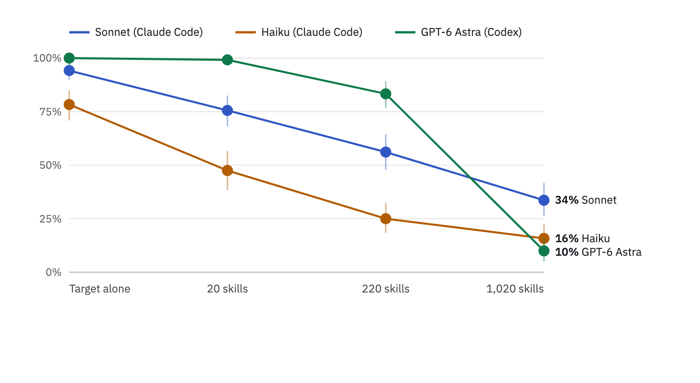
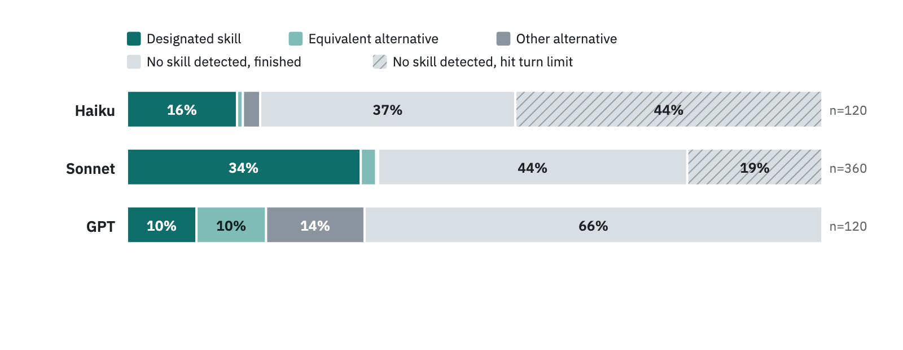
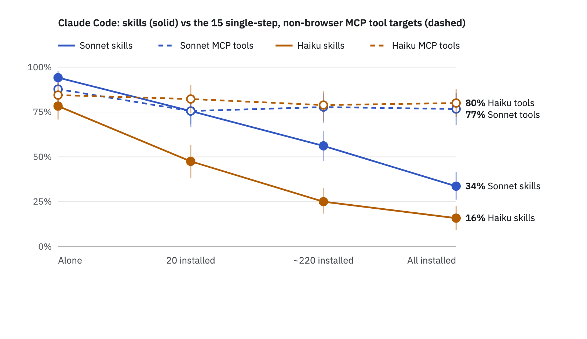
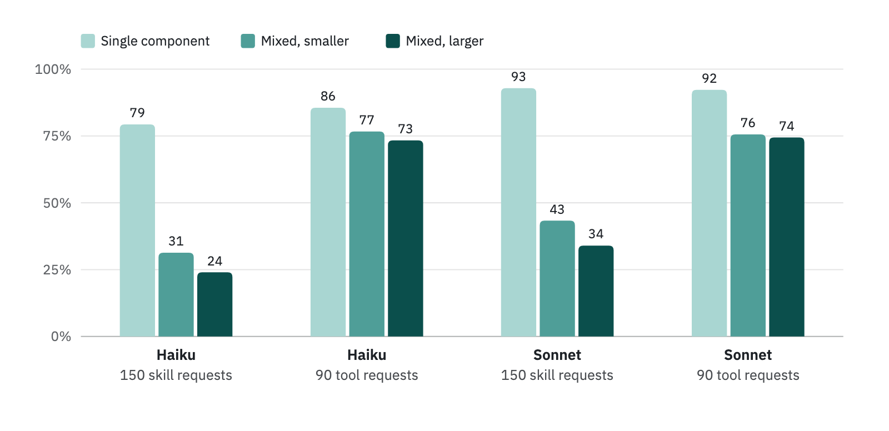

<!-- A readable copy of the post, made by post/build_md.py. To suggest changes, edit this file in a pull request;
     they are carried over into post/build_post2.py, which builds the page. Numbers, tables and charts come from
     the data, so if you think one is wrong, say so in the PR rather than changing the number. -->

AI Agents · Claude Code · Codex · Agent Skills · MCP

# A Closet Full of Skills and Nothing to Wear: The More Skills You Install, the Less Often Your Agent Picks the Right One (MCP Tools Hold Up Better)

*I installed up to 1,000 skills and 791 MCP tools in Claude Code and Codex. The right skill went from being picked 78–100% of the time to 10–34%. In Claude Code, single-step MCP tool selection fell much less, from 84–88% to 77–80%, and held steady from 220 to 791 tools.*

Galina Alperovich · November 2026

The experiment, data and analysis: [github.com/galinaalperovich/closet-full-of-skills](https://github.com/galinaalperovich/closet-full-of-skills). Every request, every result record and every script, so you can reproduce all the numbers for free.

A skill to check your own agent: coming soon

tldr; Installing a skill doesn’t mean your agent will use it. I sent 120 natural requests to Claude Code and Codex, each written for one particular skill. With only that skill installed, the agent picked it in 78–100% of runs. With 1,000 other skills next to it, in only 10–34%. MCP tools held up much better: in Claude Code, single-step tool selection went from 84–88% with the tool alone to 77–80% with all 791 tools installed. The experiment has its limits (empty folders, stub skills, a short observation window, one sample of extra skills), but they don’t change the main point: the more you install, the less reliably the right skill gets picked. At the end I share a few tricks for dealing with it.

<!-- The table of contents is made from the headings. -->

Agent skills became **the new npm**. A skill is a folder with a `SKILL.md` file: a name, a short description, and instructions the agent reads only when it needs them. The biggest community collection I found, [sickn33/agentic-awesome-skills](https://github.com/sickn33/agentic-awesome-skills), has over 3,000 skills, and its README invites you to install all of them. MCP servers went the same way: one GitHub server alone exposes 149 tools.

Here is what made me curious. The agent chooses a skill from its description, and the descriptions in that one collection add up to about 129K tokens. *The Great Gatsby* is about 72K. No harness sends **two Gatsbys** with every request: Claude Code and Codex both cap the listing. So what happens to the skills that do not fit, and to the ones that do?

People run into this. [One Claude Code issue](https://github.com/anthropics/claude-code/issues/81081) reports that 75% of project skills (27 of 36) reached the model with only a name, and [one user counted](https://github.com/anthropics/claude-code/issues/11364) 67,300 tokens of tool definitions from seven MCP servers before the first message. More reports are in the references. What I did not find was the selection rate itself, measured for skills next to MCP tools.

## Why this is a problem

A skipped skill or tool does not fail loudly. The agent still answers, with its built-in tools and what it already knows, and the result looks plausible. That is the dangerous case when the skill or tool carries something the model does not have: your release checklist, a house template, a compliance rule, or live data. Ask for Apple’s stock price without the finance tool being called, and you may get **a confident number from the model’s memory**.

Skipping a skill also costs more than one step. A skill is often a recipe that tells the agent which tools to call and in which order: run the linter, then the tests, then open the pull request. **Skip the skill, and you skip every tool call it would have made.**

These are everyday setups, not edge cases: a few plugins and MCP servers are enough, as the reports above show. Nothing in the answer says the skill was never loaded. Only the trace does, and unless you log tool calls and check for the ones that should have happened, you will not know.

## How an agent picks a skill or a tool

First, the two things I compare. A **skill** is a folder of instructions (`SKILL.md`) that the agent reads when a task matches its description: it teaches the agent *how* to do something. An **MCP tool** is a function on a server that the agent calls with arguments and gets a result back: it *does* one thing, such as creating an issue or fetching a page.

**Loading a skill is itself a tool call.** In Claude Code the model calls the `Skill` tool; in Codex it reads the file with a shell command such as `cat .agents/skills/pdf/SKILL.md`. That call returns the skill’s instructions, and the actual work happens in the tool calls that follow. So a skill is a tool call with an extra step in front, while an MCP tool does its work in the call itself. The first call is what I count as “selected”.

MCP tools also reach the model differently. In Claude Code the model sees only the tool names and loads a full definition when it needs one, with a `ToolSearch` call. That is a feature of the Claude Code harness. In your own agent built on a model API, every tool definition you pass is sent in full, and search is yours to build (see [[Trick #3]](#trick-search)).

![Diagram. Every request is sent with the skill listing (all names and descriptions, capped at a share of the context) and with MCP tool definitions. Claude Code sends tool names and fetches schemas on demand with ToolSearch; for Codex, reported tokens grew when 20 tool definitions were added. The model loads a skill, calls a tool, or uses only built-in actions. Loading a skill is itself a tool call (the Skill tool in Claude Code, a shell read of SKILL.md in Codex) that returns the skill instructions; the work then happens in more tool calls.](images2/fig_how.png)

*Figure 1. How a request reaches a skill or a tool. The request arrives together with a capped skill listing and the MCP tools. The model loads a skill, calls a tool, or uses only the harness’s built-in actions (search files, read, run a shell). Loading a skill is itself a tool call: it returns the skill’s instructions, and the work then happens in further tool calls.*

It helps to see the whole thing as a pipeline, because I measured only one stage of it:

1. **Installed.** The skill folder or MCP server is on disk and enabled.
2. **Listed.** The harness builds a listing of names and descriptions within a budget. Claude Code gives it [1% of the context window and drops descriptions when it overflows](https://code.claude.com/docs/en/skills.md). Codex gives it [2%, at most 10,000 tokens, and shortens descriptions first](https://learn.chatgpt.com/docs/build-skills).
3. **Selected.** The model decides to load a skill or call a tool. **This is the stage I measured.**
4. **Loaded and used.** The full `SKILL.md` is read, the tool runs, the task gets done. Not measured.

## The experiment setup


*Figure 2. The design in one picture. The same request is sent in four setups, from the target alone to 1,000 other skills (or 791 tools), and I count how often the agent picks the target.*

I picked 20 well-known skills ([Anthropic’s](https://github.com/anthropics/skills) pdf, xlsx, pptx and docx, [Matt Pocock’s](https://github.com/mattpocock/skills) tdd and grill-me, and others; see [Appendix A](#appendix-a) for the full list of skills used in the experiment) and 20 everyday MCP tools out of 791 real tool definitions from 73 servers ([GitHub](https://github.com/github/github-mcp-server), [Chrome DevTools](https://github.com/ChromeDevTools/chrome-devtools-mcp), [Playwright](https://github.com/microsoft/playwright-mcp), and 70 servers from [LiveMCPBench](https://github.com/icip-cas/LiveMCPBench)).

For each target I used an LLM to write six realistic requests, phrased the way a person would ask, with no explicit invocation: no `/pdf`, no “use the pdf skill”. Some overlap with names is unavoidable: 63 of the 150 skill requests share a word with the skill’s name, such as “pdf” or “grill”. [All requests are in the repo.](https://github.com/galinaalperovich/closet-full-of-skills/blob/main/prompts.json)

*Table 1. Example requests. Every target had six like these.*

| Target | Example requests |
|---|---|
| `pdf` skill | “Merge invoice-jan.pdf and invoice-feb.pdf in this folder into a single file.” |
| `seo-audit` skill | “Why did our organic traffic drop last month?” |
| `grill-me` skill | “Grill me on this plan before I start building.” |
| `github.create_issue` tool | “Open an issue in acme/webapp saying the login button is broken on Safari.” |

Each request ran in four setups:

1. **Alone:** only the target is installed. “Alone” still includes what the harness ships: Claude Code reported 23 built-in skills in every setup, plus its built-in tools.
2. **20:** all 20 targets together.
3. **~220:** the 20 plus 200 others, drawn at random.
4. **All:** the 20 plus 1,000 other skills, or all 771 other tools.

The configurations: Claude Haiku and Claude Sonnet in Claude Code (v2.1.328), and GPT (gpt-6-astra, medium reasoning) in Codex CLI (v0.160.0). Differences between them belong to the whole configuration, not to the model alone.

Four details matter for reading the numbers:

- **Stubs.** Every skill keeps its real name and description, but its instructions are one line: “reply with one short sentence”. MCP tools return a similar stub. Whatever happens *after* the first selection is not normal behaviour.
- **Empty folders.** Each run starts in a folder with no files, so a request about `report.pdf` has no such file.
- **Observation window.** Claude Code was capped at 3 turns (4 with MCP). Why so short? Picking a skill or a tool is the first decision an agent makes, and it almost always happens in the first turn or two. A short cap kept thousands of runs fast and affordable. The price is that a later selection is not seen. A Codex run is one user turn, which can contain several model and tool steps, with no cap.
- **Scoring.** A skill request counts only if the designated skill is selected. A tool request also counts an equivalent tool on another server. Afterwards, a separate Claude session rated every selected alternative, seeing only the request and the two descriptions. That is a retrospective rating by a model, not human validation ([prompt and rules](https://github.com/galinaalperovich/closet-full-of-skills/blob/main/analysis/alt_judge_prompt.md)).

**How to read the numbers.**

- **Unit of analysis: the request.** Each configuration got 120 skill requests and 90 single-step tool requests. Sonnet ran every skill request three times, and its repeats are averaged within the request, so each request counts once. Haiku and GPT ran each request once, GPT because of the API budget.
- **Intervals.** 95% confidence intervals (CIs) come from a request-cluster bootstrap (2,000 resamples, fixed seed). Where every run succeeded (GPT alone, 120 of 120), the bootstrap collapses to a point, so I use a Wilson score interval instead.
- **Changes are paired.** A change between two setups compares the same requests, in percentage points (pp), with a bootstrap CI for the mean paired difference.
- **Robustness.** A two-stage bootstrap that also resamples which skills were chosen gives wider CIs (in the [methodology](https://github.com/galinaalperovich/closet-full-of-skills/blob/main/METHODOLOGY.md)). Every skill drop from “alone” to 1,020 skills still excludes zero. For MCP tools, the two-stage CI from alone to 791 tools includes zero for Haiku (−14 to +3 pp), but not for Sonnet (−24 to −1 pp).
- **What the intervals do not cover:** the single random draw of extra skills, the wording of these particular requests, and harness versions. The analysis is exploratory, with no correction for multiple comparisons.

## Result 1: Skills fade

*Table 2. Share of requests where the agent picked the designated skill, with 95% CIs.*

| Setup | Skills | Haiku (Claude Code) | Sonnet (Claude Code) | GPT (Codex) |
|---|---|---|---|---|
| Target skill alone | 1 | 78% [71–85] | 94% [90–98] | 100% [97–100] |
| 20 skills together | 20 | 48% [38–57] | 76% [68–82] | 99% [98–100] |
| Plus 200 others | 220 | 25% [18–32] | 56% [48–64] | 83% [77–89] |
| Plus 1,000 others | 1,020 | 16% [9–22] | 34% [26–42] | 10% [5–16] |

CIs: request-cluster bootstrap; Wilson score interval for GPT alone (120 of 120).



*Figure 3. Share of requests where the designated skill was selected within the observation window. Bars are 95% CIs from resampling requests, except GPT alone (120 of 120), which uses a Wilson score CI. Sonnet ran each request 3 times (360 runs per point); Haiku and GPT once (120). The x axis is not to scale.*

**The decline is already there at 20.** These are 20 skills about different things: PDFs, SEO, TDD, animation. On the same requests, Haiku lost 31 points and Sonnet 17, and almost no request got better. You do not need 1,000 skills to see it: **twenty is enough**. The 20 descriptions total only about 7,700 characters, but Claude Code’s built-in skills and the listing format also count toward its budget, and I did not capture the listing the model received. So this setup cannot separate competition between entries from truncation.

**GPT holds, then falls off a cliff:** 99% at 20 skills, 83% at 220 and **10%** at 1,020. Codex reports how many tokens it writes to its cache in each run, and that number barely grew (13.2K → 20.3K tokens) while the descriptions I installed grew by about 45K. That fits Codex’s [documented 10,000-token cap on the listing](https://learn.chatgpt.com/docs/build-skills), but it is a weak inference: I did not see what the model saw.

**A stronger model helped, but did not remove the decline.** Sonnet was ahead of Haiku at every size, and both fell.

### When the right skill was not picked, what did the agent do instead?

A miss can mean three different things. The agent picked another skill, sometimes an equally good one. It picked no skill at all and carried on with its built-in tools. Or it ran out of turns before choosing anything. Figure 4 splits the runs with 1,020 skills into these groups.



*Figure 4. Outcomes with 1,020 skills installed. “Equivalent alternative”: the rater judged the other skill a fine choice for that request. “Other alternative” combines alternatives rated related, inappropriate or unassessable. Hatched: the run hit Claude Code’s 3-turn limit with no skill selected.*

Most misses were not a wrong skill. They were runs with **no skill at all**, which changes the debugging question from “why this wrong skill?” to “was a skill exposed and selected at all?” What the agent did in those runs instead is worth investigating further.

- **Haiku:** more than half of its no-skill runs (53 of 97) hit the 3-turn limit. With a longer window, some of them might have picked the skill later.
- **Sonnet:** two thirds of its misses (160 of 239) ended normally, with no skill selected.
- **GPT:** about a quarter of its misses (29 of 108) picked a different skill, and the rater judged 12 of those equivalent. Counting them, GPT’s rate at 1,020 skills is 20%, not 10%.

One request shows why that adjustment matters. “Interview me about my plan for the onboarding redesign” was written for `grill-me`. With 220 skills installed, all three configurations selected `interview-me` instead. Strict scoring counts three misses. The rater called the alternative equivalent, and I agree.

### Which skills kept being selected


*Figure 5. Sonnet. Each arrow runs from a skill installed alone (hollow dot) to the same skill among 1,020 others (filled dot), 18 runs each: 6 requests × 3 repetitions. A skill with no arrow did not change. Skills are grouped by where they end up. At this size a 95% Wilson CI is wide (14 of 18 is 78%, 95% CI 55–91%), so a difference of a run or two is noise.*

Two contrasting cases. `grill-me` went from 100% to 94%: nothing else in the crowd is named “grill”. `seo-audit` went from 100% to **0%**, next to 16 other skills mentioning “seo”. Skills with an unusual name or file type (`json-canvas`, `xlsx`) held up, and skills on a crowded topic (security, debugging, animation) did not. My design cannot show that distinctiveness is the cause.

## Result 2: MCP tools hold up better

Then I repeated the whole design with MCP tools. I picked 20 everyday tools, such as creating a GitHub issue, taking a screenshot of a web page or getting a stock price, and served each one from its real published definition. Each tool request ran in four setups: (1) only the target tool; (2) all 20 target tools together; (3) the 20 plus 200 random tools, about 220 in total; (4) all 791 tools from 73 servers.

**The tools held up much better.** With the target tool alone, Claude Code picked it for 84% (Haiku) and 88% (Sonnet) of the single-step requests. With all 791 tools installed, it still did for 80% and 77%. Skills, remember, fell to 16% and 34%.



*Figure 6. Claude Code only. Skills (solid lines) against the 15 single-step MCP tool targets (dashed lines). Bars are 95% CIs from resampling requests. “All installed” means 1,020 skills or 791 tools. The two experiments use different tasks and scoring rules, and the x axis is not to scale.*

What loss there was came mostly at the first step, from one tool to twenty, where near neighbours appear for the first time: four GitHub tools, two browser servers. After that the curve is flat. Adding 571 more tools, from about 220 to 791, changed **nothing measurable** (79% → 80% for Haiku, 78% → 77% for Sonnet). “No change observed” is not proof of no effect, but it is a very different picture from the skills.

*Table 3. Share of tool requests where Claude Code called the designated tool (or an equivalent one), with 95% CIs.*

| Tools installed | Haiku · 15 single-step | Sonnet · 15 single-step | Sonnet · all 20 |
|---|---|---|---|
| Target alone | 84% [77–91] | 88% [81–94] | 78% [71–85] |
| 20 | 82% [74–90] | 76% [67–84] | 62% [52–70] |
| ~220 | 79% [70–87] | 78% [69–86] | 59% [51–68] |
| 791 | 80% [72–88] | 77% [68–86] | 58% [49–67] |

“15 single-step”: the targets that need one call. “All 20”: including the five browser targets described below. CIs: request-cluster bootstrap.

**Five of the tools measured my setup, not the agent.** “Take a screenshot of example.com” needs two steps: open the page, then take the screenshot. In the larger setups the agent did the sensible thing. It loaded both tools, opened the page, got my stub reply (“reply with one short sentence”), and stopped. In all 120 browser runs of the two larger setups, the agent had already loaded the target tool’s definition with `ToolSearch`. So for these five targets I know the agent found the right tool, but not whether it would have used it. I report them separately and keep them out of the main curve.

**GPT is only partly measured.** With the target tool alone, GPT picked it 91% of the time. With 20 tools I ran only 24 of the 90 requests before I paused the GPT runs to save budget. On those 24, selection went from 100% to 92%. I have no GPT data for the larger tool setups.

## Result 3: Skills and tools together

Real setups have both. I built two: a smaller one with 100 skills and 437 tools, and a larger one with 400 skills and all 791 tools, including servers that overlap with skills (`xlsx` next to an Excel server). Then I sent the skill requests (the 20 targets plus five skills from repos trending this month, 150 in total) and the tool requests.



*Figure 7. Claude Code. Share of requests where the designated component was selected. “Single component” is the target installed alone, with every request weighted equally. Tool requests are the 90 for the 15 single-step targets. Whiskers: 95% CI (request-cluster bootstrap).*

**The same pattern, only stronger.** Compared with the component installed alone, skill requests lost 46–60 points and single-step tool requests lost 6–18. Read that gap with some care:

- **The scoring is not symmetric.** A skill request counts only the exact designated skill; a tool request also counts an equivalent tool. Counting the alternatives the rater judged equivalent raises the skill rates by 1–3 points.
- **The tasks differ.** Skill requests and tool requests are different jobs, so this is not a matched comparison of skills against tools.
- **These are two setups I constructed.** Separating the effect of skills from the effect of tools needs a crossed design.

So what did the agent do when it skipped the skill? In 79% of the skill requests that missed (317 of 400), it **only used built-in tools**, mostly `Glob` and `Grep`: it went looking in the empty folder for the files the request mentioned. Three examples from Sonnet in the larger setup:

- “Merge invoice-jan.pdf and invoice-feb.pdf in this folder into a single file.” → searched the folder twice with `Glob`, then answered: “I couldn’t find invoice-jan.pdf or invoice-feb.pdf.” No `pdf` skill. (The folder is empty by design.)
- “What should we fix to rank better on Google?” → four `Glob` searches and a `Grep`, then: “I can’t tell what to fix yet, because there’s no website in this working directory.” No `seo` skill.
- “Open sales.xlsx and add a column with the month-over-month growth.” → selected the `xlsx` skill first, then looked for the file.

## Why did tools hold up better than skills?

Put both experiments on one scale, and the difference is hard to miss. The forest plot below shows, for every configuration, how much selection changed compared with the target installed alone, on the same requests. The skill rows slide further left as the collection grows. The tool rows stay close to zero.


*Figure 8. Paired change from the target alone, in percentage points, with 95% CIs (request-cluster bootstrap). Filled dots: skills, 120 requests per row. Hollow dots: the 15 single-step MCP tool targets, 90 requests per row. GPT with 20 tools covers only the 24 requests that were run.*

My data cannot say why, but here is the intuition I find most convincing. **A skill listing is like a restaurant menu printed on one page.** Every dish has to fit, so the more dishes there are, the smaller the print, and past a certain size the printer starts dropping descriptions. The model reads that whole page with every request and has to spot the right line. **MCP tools in Claude Code work more like asking the waiter.** The model sees only the tool names, and when it needs one it searches and gets the full definition back. Claude Code called `ToolSearch` in 62–92% of the MCP runs. A long menu barely matters if you can ask for what you want.

Two more things probably help the tools. A tool name is usually a verb that matches the request almost literally (`create_issue`, `take_screenshot`, `get_current_stock_price`), while a skill describes a whole workflow in broad words that its neighbours share: 16 skills in my crowd mention “seo”. And a tool request asks for an action, while a skill request describes a goal, which leaves more room for the model to decide it can manage on its own.

Treat all of this as hypotheses. The two experiments use different tasks and different scoring, so this is not a matched comparison of skills against tools. The test that would settle it is described in [What’s next](#what-s-next).

## What else might explain the skill decline?

The data show where selection changed, not why. Here are the explanations I find plausible, what I observed for each, and what is missing. My logs cannot separate them.

*Table 4. Possible explanations for the skill decline.*

| Possible explanation | What I observed | What is missing |
|---|---|---|
| **The entry never reached the model** (listing budget) | Both [Claude Code](https://code.claude.com/docs/en/skills.md) and [Codex](https://learn.chatgpt.com/docs/build-skills) document caps on the listing. At 220 and 1,020 skills, my descriptions were far over Claude Code’s budget, and Codex’s cache-write totals nearly stopped growing. | The listing as the model received it. I never captured it. |
| **Visible entries compete** | `seo-audit` fell from 100% to 0% next to 16 other “seo” skills, while `grill-me` held at 94%. | A test that keeps every description visible and varies only the look-alikes. |
| **The agent can proceed without a skill** | Most misses had no skill selected at all. In the mixed setups the agent searched the folder with `Glob` and `Grep` instead. | Whether the task got done. Only the rerun mixed runs kept the agent’s text. |

Research on long contexts makes the second explanation plausible without proving it here. [NoLiMa](https://arxiv.org/abs/2502.05167) found that when a question shares no words with the passage it needs, even one of the stronger models it tested fell from 99.3% to 69.7% at 32K tokens. Chroma’s [Context Rot](https://research.trychroma.com/context-rot) study reports that on-topic distractors hurt more than unrelated ones. Those are different tasks, models and metrics, so I treat them as background, not as evidence about my runs. (A toy calculation of the dilution idea is in [Appendix C](#appendix-c).)

**Why measure selection at all**, if the answer may still be fine? Because some skills are procedures you require: a release checklist, a security review, a house style. Skipping one of those matters even when the task looks done. For a convenience wrapper, it may not.

## What you can do about it

*Table 5. What I observed, how sure I am, and what to do about it.*

| What I observed | How sure | What to do |
|---|---|---|
| Selection of the designated skill fell as more skills were installed, starting at 20 | Measured; 95% CIs exclude zero from 20 skills on (Claude); one sample of extra skills | Enable fewer skills per project |
| Most misses had no skill selected at all | Measured; the cause is unknown | Check what the model can see before rewriting descriptions |
| Single-step MCP selection in Claude Code held from 220 to 791 tools | Measured: no change, paired 95% CIs within ±7 points; search not isolated | Prefer search over a full listing where you can |

### [Trick #1] Check what is actually exposed

In Claude Code, `/context` shows the size of your skill listing and [`/doctor` tells you whether descriptions are being dropped](https://code.claude.com/docs/en/skills.md). Codex prints a warning when it goes over its budget ([codex#19679](https://github.com/openai/codex/issues/19679)). Blake Crosley wrote a good account of [the skills his agent could not see](https://blakecrosley.com/blog/skills-my-agent-could-not-see). This is a diagnostic, and it is the first thing I would do.

### [Trick #2] Enable less, per project

This is the one manipulation I tested: with fewer skills installed, the designated one was selected more often (answer quality not measured). Enable plugins per project, turn off unused skills with `/skills`, and if you only need `pdf` from a 3,000-skill collection, install `pdf`. Overlapping collections can expose the same skill twice, a case I did not measure, so check what is actually enabled.

### [Trick #3] Test other ways to discover and invoke (untested here)

- **Invoke required skills by name** (`/skill-name`) instead of hoping for a match.
- **Give a skill a trigger nobody else has.** The skills that held in my sample had concrete nouns and file types. That is an observation, not a controlled test.
- **Raise the listing budget** ([`skillListingBudgetFraction` in Claude Code](https://code.claude.com/docs/en/skills.md), [`skills.max_context_tokens` in Codex](https://learn.chatgpt.com/docs/build-skills)). You pay for it on every request.
- **Use a router skill or a hook.** Scott Spence measured [a hook that makes Claude evaluate skills before answering](https://scottspence.com/posts/how-to-make-claude-code-skills-activate-reliably): 84% activation against 20% for a simple keyword hook. Ivan Seleznov ran [650 activation trials](https://medium.com/@ivan.seleznov1/why-claude-code-skills-dont-activate-and-how-to-fix-it-86f679409af1) on similar ideas.
- **Search instead of listing.** Claude Code already defers MCP tools behind [tool search](https://platform.claude.com/docs/en/agents-and-tools/tool-use/tool-search-tool). In your own agent you have to build it: the Claude API’s tool search tool can defer tools, and with any model you can embed the descriptions and retrieve the closest few. [RAG-MCP](https://arxiv.org/abs/2505.03275) reports 13.6% → 43.1% tool selection with retrieval, and Anthropic 49% → 74% on [an internal evaluation](https://anthropic.com/engineering/advanced-tool-use). Neither is measured for skills.

## Check your own agent

Pick a skill you rely on, go to a real project folder where the files it needs exist, and send a few requests the way you would really ask:

```
# Claude Code: prints the skill or MCP tool it selected
claude -p "Audit the SEO of my site." --output-format stream-json --verbose --max-turns 3 \
  | jq -r 'select(.type=="assistant") | .message.content[]?
           | select(.type=="tool_use") | select(.name=="Skill" or (.name|startswith("mcp__")))
           | if .name=="Skill" then "skill: " + .input.skill else "tool: " + .name end'

# Codex: prints the SKILL.md files it read
codex exec --json -s read-only "Audit the SEO of my site." \
  | grep -o 'skills/[a-z0-9-]*/SKILL.md' | sort -u
```

Then repeat with only that skill enabled. A handful of requests will not give you a reliable rate, but it will show whether the skill is ever selected. I would genuinely love to see your numbers.

Two things I learned the hard way, both of which forced me to rerun part of this study:

- **In `-p` mode, Claude Code refuses MCP calls you have not allowed.** Nobody is there to approve them. The command above still prints the selection, but whatever the agent does next is a reaction to the refusal. Add `--allowedTools mcp__<server>` for the servers you are testing.
- **Claude Code keeps a memory per folder.** A note saved in one test run is loaded at the start of the next run in the same folder. Use a fresh folder for every run, or check `~/.claude/projects/` between runs.

## What this cost

*Table 6. What the runs cost.*

| Item | Runs | Cost |
|---|---|---|
| GPT, skills experiment (OpenAI API) | 480 | $119.13 |
| GPT, MCP experiment so far (OpenAI API) | 170 | $52.60 |
| **Calculated API fees** | 650 | **$171.73** |
| Claude Haiku and Sonnet in Claude Code, the runs in these results (my Claude subscription; API list price for reference) | 4,020 | $0 extra ($198.02 list) |
| Claude Code runs I discarded: the first MCP and mixed runs, a rerun I stopped, and 18 skill runs I repeated (same subscription) | 3,233 | $0 extra ($149.64 list) |

The GPT figures are calculated from the token usage Codex reported, at [OpenAI’s list prices](https://developers.openai.com/api/docs/models/gpt-6-astra.md). I have not reconciled them against the invoice. Cache writes were 76–87% of each run’s calculated cost. [The per-batch breakdown is in the repo.](https://github.com/galinaalperovich/closet-full-of-skills/blob/main/analysis/derived/v2/cost_by_batch.csv)

Running every remaining GPT cell at full size would cost about $1,400 by my estimate, most of it in the mixed setups. That assumes Codex loads every tool definition, as my 20-tool runs suggest. [Another measured post](https://contextbolt.com/blog/too-many-mcp-servers/) reports that Codex defers MCP tools, so the estimate may be too high. I have not reconciled the two.

## Limitations of the experiment

- **Selection, not quality.** A run without the skill can still produce a fine answer.
- **Minimal setup.** Empty folders, stub instructions, and 3–4 turns in Claude Code. Some capped runs might have selected the skill later.
- **No captured listing, little response text.** I know what was called, not what the model saw. Full logs, including what the agent wrote, exist only for the rerun Claude Code MCP and mixed runs.
- **Few samples.** One random sample of extra skills, and six LLM-written requests per target. The CIs cover variation across these requests and runs, not the draw of extra skills or the wording of the requests.
- **Configurations, not models.** Claude Code and Codex differ in model, prompts, budgets and permissions. For example, Codex could search the web in these runs, and Claude Code could not.
- **GPT data is thinner.** One run per request, and MCP only with 1 tool and, partly, with 20.
- **Things change.** Harness limits, commands and prices are as documented in November 2026. The issue reports I link are motivation, not evidence of current behaviour.

The [full methodology](https://github.com/galinaalperovich/closet-full-of-skills/blob/main/METHODOLOGY.md), [an external review of it](https://github.com/galinaalperovich/closet-full-of-skills/blob/main/METHODOLOGY_REVIEW.md), [my response to that review](https://github.com/galinaalperovich/closet-full-of-skills/blob/main/analysis/CHANGELOG.md), and all data and scripts are in [the GitHub repo](https://github.com/galinaalperovich/closet-full-of-skills).

## What’s next

This experiment highlights three things. **Installing a skill is not the same as having it available** when a request needs it. The decline starts early, already at 20 skills. And tools that the agent finds by search held up much better than skills that sit in one long listing.

The next steps I would check:

1. **Validation.** Capture the listing the model actually receives, put real files in the folders, and give Claude 10 turns instead of 3.
2. **Search for skills.** Does a `ToolSearch`-style step help skills the way it seems to help tools? The clean test keeps the visible listing and the files constant and varies only the number of look-alikes, with search on and off.
3. **More catalogs and controls.** Other random samples of extra skills, control requests, and skills and tools varied separately.

Also worth looking at: other harnesses (Cursor, Gemini CLI), skills that call other tools, where one missed selection costs a whole chain of calls, and the quality of the final answer, not just the selection. The full plan with costs is in [the follow-up protocol](https://github.com/galinaalperovich/closet-full-of-skills/blob/main/FOLLOWUP_PROTOCOL.md).

If you want to contribute: [the experiment repo](https://github.com/galinaalperovich/closet-full-of-skills) is open, and reruns on newer harness versions, other models or other harnesses are very welcome. The skill for checking your own setup is coming soon.

## Conclusion

I started with a simple question: if I install a thousand skills, does my agent get more capable? What changed my view is the difference between installing a capability and having it reliably available when a request needs it. In this test, selection of the designated skill fell as the collection grew, while single-step MCP tool selection in Claude Code held up better. Before adding another big collection, I would check what the agent can actually see, and I would measure answer quality separately before deciding that more activation is always better.

Thanks for reading! If you run the check on your own setup, tell me what you got.

## Appendix A: The 20 target skills

*Table 7. The 20 target skills, where they come from, and one of their six requests.*

| # | Skill | From | What it does | One of its six requests |
|---|---|---|---|---|
| 1 | `pdf` | [anthropics/skills](https://github.com/anthropics/skills) | Read, merge, split and edit PDF files | “Merge invoice-jan.pdf and invoice-feb.pdf in this folder into a single file.” |
| 2 | `xlsx` | [anthropics/skills](https://github.com/anthropics/skills) | Create and edit spreadsheets | “Open sales.xlsx and add a column with the month-over-month growth.” |
| 3 | `pptx` | [anthropics/skills](https://github.com/anthropics/skills) | Create and edit PowerPoint decks | “Make a 10-slide pitch deck for my coffee subscription startup as a PowerPoint file.” |
| 4 | `docx` | [anthropics/skills](https://github.com/anthropics/skills) | Create and edit Word documents | “Write up these meeting notes as a Word document with headings.” |
| 5 | `webapp-testing` | [anthropics/skills](https://github.com/anthropics/skills) | Test local web apps with Playwright | “My app is running on localhost:3000. Check that the login form actually works.” |
| 6 | `mcp-builder` | [anthropics/skills](https://github.com/anthropics/skills) | Guide to building MCP servers | “I want to build an MCP server that exposes our internal ticketing API to Claude.” |
| 7 | `frontend-design` | [anthropics/skills](https://github.com/anthropics/skills) | Distinctive visual design for UI | “Build a landing page for my design studio. I don’t want it to look generic.” |
| 8 | `tdd` | [mattpocock/skills](https://github.com/mattpocock/skills) | Test-driven development | “Add a discount code feature to the cart, and do it test-first.” |
| 9 | `grill-me` | [mattpocock/skills](https://github.com/mattpocock/skills) | A relentless interview to sharpen a plan | “Grill me on this plan before I start building.” |
| 10 | `diagnosing-bugs` | [mattpocock/skills](https://github.com/mattpocock/skills) | Diagnosis loop for hard bugs and slowdowns | “Diagnose why the checkout page throws a 500 only in production.” |
| 11 | `obsidian-markdown` | [obsidianmd/obsidian-skills](https://github.com/obsidianmd/obsidian-skills) | Obsidian Markdown: wikilinks, callouts, properties | “Write a note for my Obsidian vault about project Atlas with wikilinks to the people involved.” |
| 12 | `json-canvas` | [obsidianmd/obsidian-skills](https://github.com/obsidianmd/obsidian-skills) | Create and edit .canvas files | “Create a .canvas file mapping out the architecture of this app.” |
| 13 | `humanizer` | [blader/humanizer](https://github.com/blader/humanizer) | Rewrite AI-sounding text | “This paragraph sounds like ChatGPT wrote it. Make it sound like a person.” |
| 14 | `vercel-react-best-practices` | [vercel-labs/agent-skills](https://github.com/vercel-labs/agent-skills) | React and Next.js performance guidelines | “Review this Next.js page for performance problems.” |
| 15 | `web-design-guidelines` | [vercel-labs/agent-skills](https://github.com/vercel-labs/agent-skills) | Review UI code against web interface guidelines | “Review my UI code for accessibility problems.” |
| 16 | `security-and-hardening` | [addyosmani/agent-skills](https://github.com/addyosmani/agent-skills) | Harden code against vulnerabilities | “Audit this login handler for vulnerabilities.” |
| 17 | `animate` | [emilkowalski/skills](https://github.com/emilkowalski/skills) | Build animations that feel right | “Add an animation to this dropdown so it feels right when it opens.” |
| 18 | `caveman` | [JuliusBrussee/caveman](https://github.com/JuliusBrussee/caveman) | Terse caveman voice | “Talk like caveman from now on.” |
| 19 | `seo-audit` | [coreyhaines31/marketingskills](https://github.com/coreyhaines31/marketingskills) | Audit and diagnose SEO | “Why did our organic traffic drop last month?” |
| 20 | `copywriting` | [coreyhaines31/marketingskills](https://github.com/coreyhaines31/marketingskills) | Write or rewrite page copy | “Rewrite the copy on our homepage.” |

## Appendix B: A survey of 42 popular skill repos

Before the experiment I cloned a sample of popular skill repositories, found through GitHub topic searches plus seven repos [trending this month](https://github.com/trending?since=monthly): 42 repos. A static script checked frontmatter, names, file links, bundled scripts and size. No code was run. This covers skills only, not MCP servers.

Two counts are used below. The repos contain 14,418 `SKILL.md` files with 7,848 distinct contents. Counting each skill name once per repo gives 6,908 skills.

- **Few structural problems.** The scanner found each issue it checks for (broken links, missing scripts, invalid names) in 0–3% of skills.
- **Few bundled tests.** It detected test or eval files for 2.6% of skills (177 of 6,908), and none at all in 64% of the repos (27 of 42). Tests can live elsewhere. [coreyhaines31/marketingskills](https://github.com/coreyhaines31/marketingskills) ships evals for all 53 of its skills.
- **Many repeated files.** 46% of the files (6,570 of 14,418) repeat another file’s content, mostly because collections ship each skill once per packaging format. That does not mean an installation loads them all.
- **Shared names.** 831 skill names appear in two or more repos. For 32% of them (270 of 831), at least two repos carry nearly identical descriptions (80% or more of the text matches), for example 18 of Anthropic’s 20 skills inside [davila7/claude-code-templates](https://github.com/davila7/claude-code-templates). A shared name is not always the same skill: `seo-audit` exists in five repos with five different descriptions.
- **Trigger phrases.** 48% of the distinct files lacked the trigger phrases my heuristic looks for (“when”, “use for”, “trigger”). That is a keyword check, not a judgment of the description.
- **Size.** Installed whole, 38% of the repos (16 of 42) have more description text than Claude Code’s listing budget for a 200K window (about 8,000 characters). The largest is roughly 60 times over, and even Anthropic’s own 20 skills are slightly over at about 9,700 characters.


*Figure 9. Estimated size of the skill descriptions if you install each collection whole. The red line is roughly Claude Code’s listing budget for a 200K window.*

**Overlapping collections.** Whether two copies of a skill are both exposed depends on how you install them. [Claude Code namespaces plugin skills](https://code.claude.com/docs/en/skills.md) as `/plugin-name:skill-name`, so both load. [Codex’s documentation](https://learn.chatgpt.com/docs/build-skills) says same-name skills are not merged. Copying folders by hand into one skills folder keeps one copy. If you install overlapping collections, check what is actually enabled. I deduplicated names in my setups, so the experiment did not measure duplicates.

## Appendix C: A toy calculation about dilution

This is illustrative arithmetic, not a model of these agents, and nothing in my data measures attention. It only shows why “more entries can dilute a match” is a reasonable thing to test.

In a [transformer](https://arxiv.org/abs/1706.03762), each attention head turns scores into weights with a softmax, and within one head the weights add up to 1:

*a<sub>i</sub>* = e<sup>*s<sub>i</sub>*</sup> / Σ<sub>*j*</sub> e<sup>*s<sub>j</sub>*</sup>

Now a cartoon with several assumptions: each skill description is one block, the target scores 20 times higher than every unrelated skill, look-alikes score the same as the target, scores do not change when entries are added, and nothing else is in the context. Then the target’s share is 20 / (20 + *n*) for *n* other skills:


*Figure 10. Toy arithmetic under the assumptions in the text. Real models have many heads and layers, scores change with the input, and an attention weight is not a probability of selecting a skill.*

Nakanishi’s [Scalable-Softmax](https://arxiv.org/abs/2501.19399) paper describes a related effect, attention weights flattening as inputs grow, and proposes a fix. That is background research, not evidence about my runs.

## References

1. Code, data and methodology for this post: [galinaalperovich/closet-full-of-skills](https://github.com/galinaalperovich/closet-full-of-skills)
2. [Claude Code documentation: Skills](https://code.claude.com/docs/en/skills.md)
3. [Codex documentation: Build skills](https://learn.chatgpt.com/docs/build-skills)
4. [Agent Skills specification](https://agentskills.io/specification)
5. [anthropics/skills](https://github.com/anthropics/skills) · [sickn33/agentic-awesome-skills](https://github.com/sickn33/agentic-awesome-skills) · [mattpocock/skills](https://github.com/mattpocock/skills) · [obsidianmd/obsidian-skills](https://github.com/obsidianmd/obsidian-skills) · [coreyhaines31/marketingskills](https://github.com/coreyhaines31/marketingskills) · [davila7/claude-code-templates](https://github.com/davila7/claude-code-templates)
6. Trending skills used in Result 3: [Nutlope/hallmark](https://github.com/Nutlope/hallmark) · [cloudflare/security-audit-skill](https://github.com/cloudflare/security-audit-skill) · [AgriciDaniel/claude-seo](https://github.com/AgriciDaniel/claude-seo) · [kajisho5/ffmpeg-skill](https://github.com/kajisho5/ffmpeg-skill) · [Jakeschincariol/instagram-agent-skill](https://github.com/Jakeschincariol/instagram-agent-skill)
7. MCP sources: [github/github-mcp-server](https://github.com/github/github-mcp-server) · [ChromeDevTools/chrome-devtools-mcp](https://github.com/ChromeDevTools/chrome-devtools-mcp) · [microsoft/playwright-mcp](https://github.com/microsoft/playwright-mcp) · [LiveMCPBench](https://github.com/icip-cas/LiveMCPBench) ([paper](https://arxiv.org/abs/2508.01780))
8. Gan & Sun. [RAG-MCP: Mitigating Prompt Bloat in LLM Tool Selection via Retrieval-Augmented Generation](https://arxiv.org/abs/2505.03275) (2025)
9. Anthropic: [Tool search tool](https://platform.claude.com/docs/en/agents-and-tools/tool-use/tool-search-tool) · [Advanced tool use](https://anthropic.com/engineering/advanced-tool-use)
10. Reports about skills: [claude-code#81081](https://github.com/anthropics/claude-code/issues/81081) · [#56710](https://github.com/anthropics/claude-code/issues/56710) · [#64606](https://github.com/anthropics/claude-code/issues/64606) · [#10768](https://github.com/anthropics/claude-code/issues/10768) · [codex#19679](https://github.com/openai/codex/issues/19679) · [r/ClaudeCode](https://www.reddit.com/r/ClaudeCode/comments/1qo0s2b/) · [r/claudeskills](https://www.reddit.com/r/claudeskills/comments/1w2a45r/) · [Jesse Vincent](https://blog.fsck.com/2025/12/17/claude-code-skills-not-triggering)
11. Reports about MCP tools: [claude-code#6915](https://github.com/anthropics/claude-code/issues/6915) · [#7328](https://github.com/anthropics/claude-code/issues/7328) · [#37793](https://github.com/anthropics/claude-code/issues/37793) · [#11364](https://github.com/anthropics/claude-code/issues/11364) · [Cursor forum 1](https://forum.cursor.com/t/tools-limited-to-40-total/67976) · [Cursor forum 2](https://forum.cursor.com/t/mcp-40-tools-way-to-less/79686) · [gemini-cli#21823](https://github.com/google-gemini/gemini-cli/issues/21823) · [r/mcp 1](https://www.reddit.com/r/mcp/comments/1xnmicj/) · [r/mcp 2](https://www.reddit.com/r/mcp/comments/1y0a4a2/)
12. [Scott Spence: How to make Claude Code skills activate reliably](https://scottspence.com/posts/how-to-make-claude-code-skills-activate-reliably) · [Ivan Seleznov: 650 trials](https://medium.com/@ivan.seleznov1/why-claude-code-skills-dont-activate-and-how-to-fix-it-86f679409af1) · [Blake Crosley: The skills my agent could not see](https://blakecrosley.com/blog/skills-my-agent-could-not-see)
13. [ContextBolt: Too Many MCP Servers? What Each One Costs, Measured](https://contextbolt.com/blog/too-many-mcp-servers/)
14. [OpenAI: gpt-6-astra model page and pricing](https://developers.openai.com/api/docs/models/gpt-6-astra.md)
15. Modarressi et al. [NoLiMa: Long-Context Evaluation Beyond Literal Matching](https://arxiv.org/abs/2502.05167) (ICML 2025)
16. Hong, Troynikov & Huber. [Context Rot: How Increasing Input Tokens Impacts LLM Performance](https://research.trychroma.com/context-rot) (Chroma, 2025)
17. Vaswani et al. [Attention Is All You Need](https://arxiv.org/abs/1706.03762) (2017)
18. Nakanishi. [Scalable-Softmax Is Superior for Attention](https://arxiv.org/abs/2501.19399) (2025)
