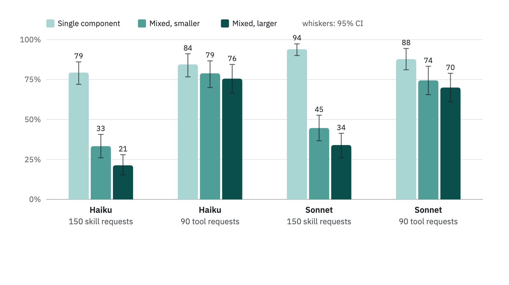

<!-- A readable copy of the post, made by post/build_md.py. To suggest changes, edit this file in a pull request;
     they are carried over into post/build_post.py, which builds the page. Numbers, tables and charts come from
     the data, so if you think one is wrong, say so in the PR rather than changing the number. -->

AI Agents · Claude Code · Codex · Agent Skills · MCP

Galina Alperovich · November 2026

# A Closet Full of Skills and Nothing to Wear: The More Skills You Install, the Less Often Your Agent Picks the Right One (MCP Tools Hold Up Better)

*I installed up to 1,000 skills and ~800 MCP tools in Claude Code and Codex, and measured how often the agent still picked the one each request was written for.*

The experiment, data, and analysis: [github.com/galinaalperovich/closet-full-of-skills](https://github.com/galinaalperovich/closet-full-of-skills). Every request, every result record, and every script, so you can reproduce all the numbers (for free).

A skill to check your own agent: *coming soon*

## Summary

Apparently, installing a skill doesn’t mean your agent will use it. I wanted to see how bad it gets, so I sent 120 natural requests to Claude Code and Codex, each written for one skill, and kept installing more and more skills. Here is what I found:

1. **Skills fade.** Alone, the skill was picked in 78–100% of runs. Among 1,000 others, in 10–34%, and in 72% for the strongest model. [→ Result 1](#result-1)
2. **For smaller models, just 20 is enough.** This one surprised me: among 20 unrelated skills, Haiku fell from 78% to 48% and Sonnet from 94% to 76%! [→ Result 1](#result-1)
3. **Past a few hundred skills, the harness quietly cuts the listing.** Of 1,020 skills, Codex listed 321, alphabetically. Claude Code kept every name but only 19 descriptions. Both harnesses have a setting that raises the cap, but it didn't help much and won back only about ten points. [→ Result 2](#result-2)
4. **A stronger model buys room, not immunity.** Fable 5.2 held at 98% up to ~220 skills and fell only after the listing was cut. For a strong model, the harness explains more of the loss than the model’s own confusion. [→ Result 2](#result-2)
5. **Most misses are no skill at all, not a wrong one.** The agent uses built-in tools or just writes the answer on its own, and nothing tells you: the answer looks plausible, which opens the door to good old hallucinations. [→ What the agent did instead](#misses)
6. **MCP tools held up better.** Single-step tool selection went from 83–96% alone to 78–84% among 791, in both harnesses. Not bad! [→ Result 3](#result-3)

The experiment has [its limits](#limitations-of-the-experiment). At the end, I share [a few tricks for dealing with this problem](#what-you-can-do-about-it).

<!-- The table of contents is made from the headings. -->

## Problem statement

Agent skills became **the new npm**. A skill is a folder with a `SKILL.md` file: a name, a short description, and instructions the agent reads only when it needs them. The biggest collection I found, [sickn33/agentic-awesome-skills](https://github.com/sickn33/agentic-awesome-skills), has over 3,000, and its README invites you to install them all. One GitHub MCP server alone exposes 149 tools.

Here is what made me curious. The agent chooses a skill from its description, and the descriptions in that one collection add up to about 129K tokens. *The Great Gatsby* is about 72K. No harness sends **two Gatsbys** with every request: Claude Code and Codex both cap the listing. So what happens to the skills that do not fit, and to the ones that do?

It is a harder version of the **needle-in-a-haystack test**. The [original](https://github.com/gkamradt/LLMTest_NeedleInAHaystack) hides one fact in a long document and asks for it. Here the needle is one skill among hundreds, and nobody asks for it: the model has to notice that the request **implicitly** asks for it. A few benchmarks study parts of this problem ([MetaTool](https://arxiv.org/abs/2310.03128), [LongFuncEval](https://arxiv.org/abs/2505.10570), [Liu et al.](https://arxiv.org/abs/2604.04323)), but none shows the full picture of a real harness. What's new in this study:

- **Real harnesses, not a bare model.** What the harness does before the model sees anything turned out to matter most.
- **Real skills and tools:** 20 popular skills and 20 published MCP tools, among up to 1,000 real skills and 791 real tool definitions.
- **Requests that never name the skill**, sent unchanged to every setup.
- **Skills and MCP tools side by side, then mixed.**
- **What the model actually received:** I captured the listing each harness sent.

## Why it matters

I used to think the worst case was the agent picking a wrong skill. It turns out the worst case is **quieter** than that:

- **A skipped skill fails silently.** The agent answers anyway. Ask for Apple’s stock price without calling the finance tool, and you may get **a confident number from the model’s memory**.
- **One skipped skill can skip a whole recipe:** run the linter, then the tests, then open the pull request.
- **If you have specific business rules to follow, it gets worse.** “We installed the skill and hoped for the best” is not convincing for an audit trail.
- **It takes an everyday setup, not an extreme one.** [One Claude Code issue](https://github.com/anthropics/claude-code/issues/81081) reports 27 of 36 project skills reaching the model with only a name, and a recent [Uber](https://x.com/UberEng/status/2125008806249930999) post says it has more than 5,000 skills in its internal marketplace, with 100 enabled for each employee by default.

## Quick background: How an agent picks a skill or a tool

A **skill** is a folder of instructions that teaches the agent *how* to do something. An **MCP tool** is a function on a server that *does* one thing, such as creating an issue.

**Loading a skill is itself a tool call.** Claude Code calls its `Skill` tool; Codex reads the file with a shell command such as `cat .agents/skills/pdf/SKILL.md`. That first call is what I count as “selected” (for Codex, a command naming the skill’s `SKILL.md`).

A skill and a tool reach the model differently. Skills sit in one listing of names and descriptions, sent with every request. MCP tools are listed by name only, and the model fetches a full definition on demand.

*Figure 1. How a request reaches a skill or a tool, with MCP tools handled the way Claude Code does it.*

Between installing a skill and the skill doing its job there are four stages:

1. **Installed.** The skill folder or MCP server is on disk and enabled.
2. **Listed.** The harness fits names and descriptions into a budget: [1% of the context window in Claude Code](https://code.claude.com/docs/en/skills.md), [2% in Codex](https://learn.chatgpt.com/docs/build-skills). **Checked afterwards.**
3. **Selected.** The model loads the skill or calls the tool. **Measured here.**
4. **Used.** The instructions are followed and the task gets done. Not measured.

## The experiment setup

*Figure 2. The same request in four setups, from the target alone to 1,000 other skills (or 791 tools).*

I needed two things: targets, and a crowd to hide them in.

- **Targets:** 20 well-known skills ([Anthropic’s](https://github.com/anthropics/skills) pdf, xlsx, pptx and docx, [Matt Pocock’s](https://github.com/mattpocock/skills) tdd and grill-me, and others; full list in [Appendix A](#appendix-a)) and 20 everyday MCP tools, such as creating a GitHub issue or getting a stock price.
- **The crowd:** 1,000 other real skills, drawn at random from [sickn33/agentic-awesome-skills](https://github.com/sickn33/agentic-awesome-skills), and 771 other real tool definitions, making 791 tools from 73 servers ([GitHub](https://github.com/github/github-mcp-server), [Chrome DevTools](https://github.com/ChromeDevTools/chrome-devtools-mcp), [Playwright](https://github.com/microsoft/playwright-mcp), and 70 from [LiveMCPBench](https://github.com/icip-cas/LiveMCPBench)).

For each target an LLM wrote six realistic requests with no explicit invocation: no `/pdf`, no “use the pdf skill” ([all requests](https://github.com/galinaalperovich/closet-full-of-skills/blob/main/prompts.json)).

*Table 1. Example requests. Every target had six like these.*

| Target | Example requests |
|---|---|
| `pdf` skill | “Merge invoice-jan.pdf and invoice-feb.pdf in this folder into a single file.” |
| `seo-audit` skill | “Why did our organic traffic drop last month?” |
| `grill-me` skill | “Grill me on this plan before I start building.” |
| `github.create_issue` tool | “Open an issue in acme/webapp saying the login button is broken on Safari.” |

Each request ran in four setups:

1. **Alone:** only the target, plus what the harness ships (23 built-in skills in Claude Code, 5 in Codex).
2. **20:** all 20 targets together.
3. **~220:** the 20 plus 200 from the crowd.
4. **All:** the 20 plus the whole crowd: 1,000 skills, or 771 tools.

Five configurations ran them: Haiku, Sonnet, and Fable 5.2 in Claude Code (v2.1.328), and GPT-6 Astra and GPT-6 Sol (medium reasoning) in Codex CLI (v0.160.0). Fable and Astra are the top models of the two families, and Sol is Astra’s sibling at a fifth of the price. Each configuration is a model plus a harness, so a difference between Codex and Claude Code may be either, but a difference between two models inside one harness is the model.

Four details matter for reading the numbers:

1. **Fake skill bodies.** Each skill keeps its real name and description, but its instructions are one line: “reply with one short sentence” (because we only need the fact of a skill being called, not the skill itself). MCP tools keep their real definitions and answer every call with “Done.”
2. **Fresh, empty folders.** Every setup sees the same thing, and Claude Code’s per-folder memory cannot carry notes from one run to the next. I learned about that memory the hard way, and reran every affected run with a little less enthusiasm than the first time.
3. **Short observation window.** Claude Code was capped at 3 turns for skills and 8 for MCP tools. Codex has no turn cap.
4. **Scoring.** A hit is exactly the designated skill, or the designated tool or an equivalent one on another server. Other picks were rated later by a separate Claude session ([prompt and rules](https://github.com/galinaalperovich/closet-full-of-skills/blob/main/analysis/alt_judge_prompt.md)).

**How to read the numbers.** Each configuration got 120 skill requests and 120 tool requests. Brackets are 95% confidence intervals from resampling requests. See full details in the [methodology](https://github.com/galinaalperovich/closet-full-of-skills/blob/main/METHODOLOGY.md).

## Result 1: Skills fade

*Table 2. Share of requests where the agent picked the designated skill, with 95% CIs. Haiku, Sonnet, and Fable ran in Claude Code. GPT-6 Astra and GPT-6 Sol in Codex.*

| Setup | Skills | Haiku | Sonnet | Fable | GPT-6 Astra | GPT-6 Sol |
|---|---|---|---|---|---|---|
| Target skill alone | 1 | 78% [71–85] | 94% [90–98] | 99% [98–100] | 100% [97–100] | 100% [97–100] |
| 20 skills together | 20 | 48% [38–57] | 76% [68–82] | 99% [98–100] | 99% [98–100] | 100% [97–100] |
| Plus 200 others | 220 | 25% [18–32] | 56% [48–64] | 98% [96–100] | 83% [77–89] | 82% [76–89] |
| Plus 1,000 others | 1,020 | 16% [9–22] | 34% [26–42] | 72% [64–80] | 10% [5–16] | 12% [6–18] |

*Figure 3. The same numbers as a chart. GPT-6 Sol is the dashed line, almost on top of GPT-6 Astra. Sonnet: 360 runs per point; the others: 120. The x axis is not to scale.*

**For Haiku and Sonnet, the decline is already there at 20.** These are 20 skills about different things: PDFs, SEO, TDD, animation. Still, Haiku fell from 78% to 48% and Sonnet from 94% to 76%. I expected trouble at a bit higher number than **20**.

**A stronger model holds longer.** I hoped a stronger model would simply fix it, and for a while it did. Fable stayed at 99%, 99%, and 98% up to ~220 skills, and only then gave way: 72% at 1,020. Still more than one request in three missed.

**In Codex, the model made no difference.** I thought the cheaper model would do worse. It drew the same curve as GPT-6 Astra: 100%, 100%, 82% and 12%, next to 100%, 99%, 83% and 10%. Result 2 shows why.

### When the designated skill was not picked, what did the agent do instead?

*Figure 4. Outcomes with 1,020 skills. Hatched: the run hit Claude Code’s 3-turn limit. “No skill detected”: no `Skill` call in Claude Code; in Codex, no command naming a `SKILL.md` (reads of Codex’s own skills under `skills/.system/` are not detected).*

I thought the model would pick wrong skills. What I found is that most misses were not a wrong skill: they were runs where **no skill was detected at all**: the agent used its built-in tools or simply answered as is.

- **Haiku:** more than half of its no-skill runs (53 of 97) hit the 3-turn limit, so a longer window might have caught later picks.
- **Sonnet:** two thirds of its misses (160 of 239) ended normally, with no skill.
- **Fable:** 18 of its 33 misses had no skill, and 15 picked a different one. 11 of those were rated equivalent, which would make its rate 82%, not 72%.
- **GPT-6 Astra and GPT-6 Sol:** about a quarter of their misses picked a different skill. Counting the ones rated equivalent (12 and 17) would make their rates 20% and 26%, not 10% and 12%.

## Result 2: What the model actually saw

At this point, I had a curve and no explanation. Was the listing cut, or did the model choose badly from a full one? So I pointed every skills setup at a stand-in server that records **what each harness actually sends**, with no model called ([scripts and results](https://github.com/galinaalperovich/closet-full-of-skills/tree/main/listing)).

*Table 3. What the skill listing contained in each setup. Haiku, Sonnet and Fable received the same listing.*

| Setup | Claude Code | Codex |
|---|---|---|
| Alone | the target, with its full description | the target, with its full description |
| 20 skills | all 37 entries, full descriptions | all 24 entries, full descriptions |
| ~220 skills | 237 names, only 100 with a description | all 224, each description cut to about 30 characters |
| 1,020 skills | 1,037 names, only 19 with a description | only 321 entries, in alphabetical order, names only: 3 of the 20 targets |

**At 20 skills, nothing was cut**, so the drop there is the model’s own choice. Everything after that is a different story: **the model was choosing from a listing that the harness had already cut.**

### One skill, three listings

This is the example that made it click for me. Take `seo-audit` and its six requests, such as “Audit the SEO of my site.”

*Table 4. The same skill, the same requests. Only the listing changed.*

| Setup | What the model saw | Picked |
|---|---|---|
| 20 skills | `seo-audit: When the user wants to audit or diagnose SEO…` | Sonnet: 18 of 18 |
| 1,020 skills, Claude Code | `seo-audit` | Sonnet: 0 of 18 |
| 1,020 skills, Codex | nothing | GPT-6 Astra: 0 of 6 |

In Claude Code the skill became a bare name among 16 other names with “seo” in them, and in Codex it was never offered.

### Codex: first shorter, then gone

- **At ~220 skills,** Codex keeps every skill but cuts each description to about 30 characters. GPT-6 Astra still picked the right skill in 83% of requests: a name and five words were nearly enough.
- **At 1,020 skills,** it listed only 321 entries, alphabetically up to “developer-listening”, with no descriptions. Of the 20 targets, only `animate`, `caveman` and `copywriting` made it in.

Those three account for 11 of GPT-6 Astra’s 12 hits at 1,020 skills and 11 of GPT-6 Sol’s 14. So **the Codex cliff is the alphabet**, not a model choosing badly. I did not believe it until I read the list myself. If your skill is called `zebra-something`, I have bad news for you!

### Claude Code: every name, few descriptions

Claude Code never drops a skill, but it drops descriptions. The listing stops growing at about 30,000 characters, already at ~220 skills. At 1,020, only 19 of 1,037 entries had a description, so the model mostly chooses from **bare names**. How much a model makes of a bare name is where the three differ: 16% for Haiku, 34% for Sonnet, 72% for Fable.

**Which descriptions survive? The ones you have used.** I noticed that the few surviving descriptions were skills I had already used, and it was not a coincidence. Claude Code records how often and how recently you used each skill, across all your projects:

- **A clean record, 1,020 skills:** none of the 20 targets had a description.
- **A record seeded with uses of `seo-audit` and `pdf`:** exactly those two got theirs back.

A twist, and this one is on me: my own runs fed that record, so I cannot say which targets had a description in each run. **A new skill in a big collection starts life as a bare name.**

### Can you just raise the cap?

Yes, both harnesses have a setting, and I nearly missed it. I thought it might fix everything, so I ran the 1,020-skill setup again with the budget at its limit:

*Table 5. The listing budget, the setting that raises it, and what raising it did at 1,020 skills (120 requests per model; listings captured with no model called).*

|  | Claude Code | Codex |
|---|---|---|
| Default budget for the skill listing | 1% of the context window | 2% of the context window |
| Setting that raises it | `skillListingBudgetFraction` in settings, or the `SLASH_COMMAND_TOOL_CHAR_BUDGET` environment variable | `skills.max_context_tokens` in `config.toml` |
| How far it goes | up to the whole context window | 10,000 tokens at most |
| Listing at 1,020 skills, default | 1,037 names, 19 with a description | 321 names, no descriptions; 3 of the 20 targets |
| Listing at 1,020 skills, setting raised | all 1,037 with a description, about 184,000 characters in every request | 618 names, still no descriptions; 9 of the 20 targets |
| Designated skill picked at 1,020 skills, default → raised | Haiku 16% → **8%** Sonnet 34% → **44%** Fable 72% → **82%** | GPT-6 Sol 12% → **41%** |

- **In Claude Code, the full listing gave back about ten points.** Not what I hoped for. Sonnet went from 34% to 44% and Fable from 72% to 82%, still far from their 94% and 99% with the skill alone. Haiku got worse. So the cut explains part of the loss, and **a thousand full descriptions are their own kind of haystack**.
- **It is not free.** The descriptions travel with every request: at list prices a Sonnet run went from $0.09 to $0.31 and a Fable run from $0.30 to $1.20.
- **In Codex, the maximum only moves the cliff.** The list runs about twice as far into the alphabet, to “maxia”, so 9 targets are offered instead of 3. GPT-6 Sol picked the right skill in 36 of 54 requests for those nine, and in 13 of 66 for the other eleven.

One run per request, so read these as directions, not precise sizes.

### What this means for your skills

- **The name does most of the work.** In a big collection it is often all the model gets, so name a skill with the words people will actually type.
- **A new skill starts at the back of the queue.** In Claude Code, used skills keep their descriptions. Calling a new one by name is the obvious way in.
- **In Codex, past about 320 skills, the end of the alphabet does not exist** (about 620 at the maximum budget). Beyond that, the only fix I know is fewer skills.

Which of the 20 skills survived, and why, is in [Appendix E](#appendix-e).

## Result 3: MCP tools hold up better

Then I repeated the design with 20 everyday MCP tools, each served from its real published definition. I expected the same collapse.

**To my surprise, the tools held up, in both harnesses.** With the target tool alone, the agent picked it for 83% (Haiku), 87% (Sonnet), 90% (Fable) and 96% (GPT-6 Sol) of the single-step requests. With all 791 tools installed, for 78%, 79%, 84% and 81%. Skills, remember, fell to 16%, 34%, 72% and 12%.

*Figure 5. Skills (solid) against the 15 single-step MCP tool targets (dashed), with 95% CIs. Haiku, Sonnet and Fable ran in Claude Code, GPT-6 Sol in Codex. Different tasks and scoring rules; the x axis is not to scale.*

What loss there was came at the first step, from one tool to twenty. After that the curve is flat: 571 more tools changed **nothing measurable**.

*Table 6. Share of single-step tool requests where the agent called the designated tool (or an equivalent one), with 95% CIs.*

| Tools installed | Haiku | Sonnet | Fable | GPT-6 Sol |
|---|---|---|---|---|
| Target alone | 83% [76–91] | 87% [79–93] | 90% [83–96] | 96% [91–99] |
| 20 | 78% [69–87] | 81% [73–89] | 87% [79–93] | 78% [69–86] |
| ~220 | 77% [68–84] | 76% [67–84] | 81% [73–89] | 86% [78–92] |
| 791 | 78% [69–86] | 79% [70–87] | 84% [77–91] | 81% [73–89] |

**Neither harness lists all the tools.** Both list MCP tools by name and have the model look a definition up (`ToolSearch` in Claude Code). That is the main difference from skills, where everything hangs on one listing.

Five of the 20 tools need a first step, such as opening a page before a screenshot, and a tool for that exists only in the two larger setups. There the agent took both steps in 90% of requests (217 of 240). I keep these five out of the curve.

## Result 4: Skills and tools together

Real setups have both, and I wondered whether mixing changes the picture. So I mixed them: 400 skills and all 791 tools in one setup, tested with Haiku and Sonnet.

*Figure 6. Sonnet in Claude Code: the component installed alone, and in the mix of 400 skills and 791 tools. Tool requests: the 15 single-step targets. Whiskers: 95% CI.*

**It does not: the same pattern.** In the mix, Sonnet picked the designated skill in 34% of requests and the designated tool in 79%. Haiku: 21% and 78%. A smaller mix of 100 skills and 437 tools was already enough: 45% and 80% for Sonnet.

When the agent skipped the skill, it mostly **used only built-in tools**: “Merge invoice-jan.pdf and invoice-feb.pdf” became two `Glob` searches in the empty folder and “I couldn’t find the files”.

## Why do skills fade while tools hold up?

*Figure 7. Change from the target alone, in percentage points, with 95% CIs, model by model. Filled dots: skills, 120 requests. Hollow dots: single-step MCP tools, 90 requests. GPT-6 Astra ran the skills experiment only.*

I can’t open the models and look inside, but three explanations fit what I saw. The first is measured; the other two are my guesses:

1. **Skills lose their descriptions; tools can be searched.** A skill listing is like **a restaurant menu printed on one page**: the more dishes, the smaller the print. Tools are more like asking the waiter: the model searches and gets the full definition back. Retrieving a few tools instead of listing them all raised selection from 13.6% to 43.1% in [RAG-MCP](https://arxiv.org/abs/2505.03275).
2. **Tools match the words of a request; skills match its meaning.** A tool name is a verb the request nearly repeats (`create_issue`). A skill describes a workflow in broad words its neighbours share ([NoLiMa](https://arxiv.org/abs/2502.05167), [Context Rot](https://research.trychroma.com/context-rot)).
3. **An action needs a tool; a goal does not.** “Open an issue” cannot be done without the GitHub tool. “Rewrite the copy on our homepage” can ([MetaTool](https://arxiv.org/abs/2310.03128)).

A toy calculation of the dilution idea is in [Appendix C](#appendix-c).

## What you can do about it

### [Trick #1] Check what is actually exposed

In Claude Code, `/context` shows the size of your skill listing and [`/doctor` tells you whether descriptions are being dropped](https://code.claude.com/docs/en/skills.md). Codex prints a warning when it goes over its budget. Since November 2026, [MCP servers can ship skills too](https://claude.com/resources/articles/skills-over-mcp-tasks-and-more), so your listing can grow without you installing anything. This is the first thing I would check.

### [Trick #2] Raise the listing budget, if you can afford it

- **Claude Code:** `skillListingBudgetFraction` in your settings (default `0.01`), or the environment variable `SLASH_COMMAND_TOOL_CHAR_BUDGET` in characters.
- **Codex:** `skills.max_context_tokens` in `config.toml`, up to 10,000.

It helped less than I hoped ([Result 2](#raise-the-cap)), and every request carries the longer listing. It makes sense when you are a little over the budget, not ten times over.

### [Trick #3] Enable less, per project

If I had to pick one trick, this is it. Enable plugins per project, turn off unused skills with `/skills`, and if you only need `pdf` from a 3,000-skill collection, install `pdf`.

### [Trick #4] Try other ways to discover and invoke (untested here)

- **Invoke required skills by name** (`/skill-name`) instead of hoping for a match.
- **Give a skill a trigger nobody else has.** In my sample, skills with concrete nouns and file types held up.
- **Use a router skill or a hook.** [A hook that makes Claude evaluate skills before answering](https://scottspence.com/posts/how-to-make-claude-code-skills-activate-reliably) reached 84% activation in Scott Spence’s test, against 20% for a keyword hook. [Uber](https://x.com/UberEng/status/2125008806249930999) keeps about 100 skills on by default and uses a `find-skills` skill to search the other 5,000.
- **Search instead of listing.** In your own agent, use the Claude API’s [tool search tool](https://platform.claude.com/docs/en/agents-and-tools/tool-use/tool-search-tool), or embed the descriptions and retrieve the closest few.

## Check your own agent

I am packaging this check as a skill you can run on your own setup (coming soon on [GitHub](https://github.com/galinaalperovich/closet-full-of-skills)). Yes, a skill that checks whether your skills get picked. I see the irony too. Let’s hope your harness picks it! Until then, the [README](https://github.com/galinaalperovich/closet-full-of-skills#check-your-own-agent) has a manual version in two commands.

## Limitations of the experiment

This is one person’s experiment, not a benchmark. Here is what it cannot tell you:

- **Selection, not quality.** A run without the skill can still produce a fine answer.
- **Selected means the agent tried to load it.** I counted the first call that loads the skill: Claude Code’s `Skill` call, or a Codex command naming the skill’s `SKILL.md`. I did not check that the skill actually loaded.
- **Listing captured afterwards**, so the exact listing of each run is unknown.
- **Few samples.** One random draw of extra skills and six LLM-written requests per target.
- **Configurations, not models.** Models can be compared inside one harness, not across the two.
- **The tool runs are a second attempt.** My first test server ended a run after its first call, and my first Codex setup blocked the calls. I repeated all tool runs with both fixed.
- **Thinner data for Fable and Codex.** One run per request, no mixed setups, and GPT-6 Astra ran the skills experiment only.

The [full methodology](https://github.com/galinaalperovich/closet-full-of-skills/blob/main/METHODOLOGY.md), all data and all scripts are in [the GitHub repo](https://github.com/galinaalperovich/closet-full-of-skills).

## What’s next

1. **Validation.** Real files in the folders, 10 turns instead of 3, and a fixed usage record so every run sees the same listing.
2. **Search for skills.** Does a `ToolSearch`-style step help skills the way it seems to help tools?
3. **More catalogs and controls.** Other draws of extra skills, other harnesses (Cursor, Gemini CLI), and the quality of the final answer.

The full plan is in [the follow-up protocol](https://github.com/galinaalperovich/closet-full-of-skills/blob/main/FOLLOWUP_PROTOCOL.md). [The repo](https://github.com/galinaalperovich/closet-full-of-skills) is open, and reruns on newer versions, other models or other harnesses are very welcome.

## Conclusion

I started with a simple question: if I install a thousand skills, does my agent get more capable? Mostly, it gets a bigger closet. What changed my view is the gap between installing a capability and having it reliably picked when a request needs it. Before adding another big collection, I would check what the agent can actually see. I still install skills. I just stopped assuming they are there.

Thanks for reading! If you run the check on your own setup, tell me what you got. And if you spot a mistake, tell me too: I have already redone half of this study once, I can take it.

## Appendix A: The 20 target skills

*Table 7. The 20 target skills, where they come from, and one of their six requests.*

| # | Skill | From | What it does | One of its six requests |
|---|---|---|---|---|
| 1 | `pdf` | [anthropics/skills](https://github.com/anthropics/skills) | Read, merge, split and edit PDF files | “Merge invoice-jan.pdf and invoice-feb.pdf in this folder into a single file.” |
| 2 | `xlsx` | [anthropics/skills](https://github.com/anthropics/skills) | Create and edit spreadsheets | “Open sales.xlsx and add a column with the month-over-month growth.” |
| 3 | `pptx` | [anthropics/skills](https://github.com/anthropics/skills) | Create and edit PowerPoint decks | “Make a 10-slide pitch deck for my coffee subscription startup as a PowerPoint file.” |
| 4 | `docx` | [anthropics/skills](https://github.com/anthropics/skills) | Create and edit Word documents | “Write up these meeting notes as a Word document with headings.” |
| 5 | `webapp-testing` | [anthropics/skills](https://github.com/anthropics/skills) | Test local web apps with Playwright | “My app is running on localhost:3000. Check that the login form actually works.” |
| 6 | `mcp-builder` | [anthropics/skills](https://github.com/anthropics/skills) | Guide to building MCP servers | “I want to build an MCP server that exposes our internal ticketing API to Claude.” |
| 7 | `frontend-design` | [anthropics/skills](https://github.com/anthropics/skills) | Distinctive visual design for UI | “Build a landing page for my design studio. I don’t want it to look generic.” |
| 8 | `tdd` | [mattpocock/skills](https://github.com/mattpocock/skills) | Test-driven development | “Add a discount code feature to the cart, and do it test-first.” |
| 9 | `grill-me` | [mattpocock/skills](https://github.com/mattpocock/skills) | A relentless interview to sharpen a plan | “Grill me on this plan before I start building.” |
| 10 | `diagnosing-bugs` | [mattpocock/skills](https://github.com/mattpocock/skills) | Diagnosis loop for hard bugs and slowdowns | “Diagnose why the checkout page throws a 500 only in production.” |
| 11 | `obsidian-markdown` | [obsidianmd/obsidian-skills](https://github.com/obsidianmd/obsidian-skills) | Obsidian Markdown: wikilinks, callouts, properties | “Write a note for my Obsidian vault about project Atlas with wikilinks to the people involved.” |
| 12 | `json-canvas` | [obsidianmd/obsidian-skills](https://github.com/obsidianmd/obsidian-skills) | Create and edit .canvas files | “Create a .canvas file mapping out the architecture of this app.” |
| 13 | `humanizer` | [blader/humanizer](https://github.com/blader/humanizer) | Rewrite AI-sounding text | “This paragraph sounds like ChatGPT wrote it. Make it sound like a person.” |
| 14 | `vercel-react-best-practices` | [vercel-labs/agent-skills](https://github.com/vercel-labs/agent-skills) | React and Next.js performance guidelines | “Review this Next.js page for performance problems.” |
| 15 | `web-design-guidelines` | [vercel-labs/agent-skills](https://github.com/vercel-labs/agent-skills) | Review UI code against web interface guidelines | “Review my UI code for accessibility problems.” |
| 16 | `security-and-hardening` | [addyosmani/agent-skills](https://github.com/addyosmani/agent-skills) | Harden code against vulnerabilities | “Audit this login handler for vulnerabilities.” |
| 17 | `animate` | [emilkowalski/skills](https://github.com/emilkowalski/skills) | Build animations that feel right | “Add an animation to this dropdown so it feels right when it opens.” |
| 18 | `caveman` | [JuliusBrussee/caveman](https://github.com/JuliusBrussee/caveman) | Terse caveman voice | “Talk like caveman from now on.” |
| 19 | `seo-audit` | [coreyhaines31/marketingskills](https://github.com/coreyhaines31/marketingskills) | Audit and diagnose SEO | “Why did our organic traffic drop last month?” |
| 20 | `copywriting` | [coreyhaines31/marketingskills](https://github.com/coreyhaines31/marketingskills) | Write or rewrite page copy | “Rewrite the copy on our homepage.” |

## Appendix B: A survey of 42 popular skill repos

Before the experiment I cloned 42 popular skill repositories, found through GitHub topic searches plus seven repos [trending this month](https://github.com/trending?since=monthly), and checked them with a static script: frontmatter, names, file links, bundled scripts and size. No code was run. They contain 14,418 `SKILL.md` files with 7,848 distinct contents; counting each skill name once per repo gives 6,908 skills.

- **Few bundled tests.** Test or eval files for 2.6% of skills (177 of 6,908), and none at all in 64% of the repos (27 of 42). Tests can live elsewhere: [coreyhaines31/marketingskills](https://github.com/coreyhaines31/marketingskills) ships evals for all 53 of its skills.
- **Many repeated files.** 46% of the files (6,570 of 14,418) repeat another file’s content, mostly the same skill shipped once per packaging format. Structural problems (broken links, missing scripts, invalid names) were rare: 0–3% of skills each.
- **Shared names.** 831 skill names appear in two or more repos. For 32% of them (270 of 831), at least two repos carry nearly identical descriptions, for example 18 of Anthropic’s 20 skills inside [davila7/claude-code-templates](https://github.com/davila7/claude-code-templates). A shared name is not always the same skill: `seo-audit` exists in five repos with five different descriptions.
- **Size.** Installed whole, 38% of the repos (16 of 42) have more description text than Claude Code’s listing budget for a 200K window (about 8,000 characters). The largest is roughly 60 times over, and even Anthropic’s own 20 skills are slightly over, at about 9,700 characters.

*Figure 8. Estimated size of the skill descriptions if you install each collection whole. The red line is roughly Claude Code’s listing budget for a 200K window.*

**Overlapping collections.** Whether two copies of a skill are both exposed depends on how you install them. [Claude Code namespaces plugin skills](https://code.claude.com/docs/en/skills.md) as `/plugin-name:skill-name`, so both load. [Codex’s documentation](https://learn.chatgpt.com/docs/build-skills) says same-name skills are not merged. Copying folders by hand into one skills folder keeps one copy. I deduplicated names in my setups, so the experiment did not measure duplicates.

## Appendix C: A toy calculation about dilution

This is illustrative arithmetic, not a model of these agents, and nothing in my data measures attention. It only shows why “more entries can dilute a match” is a reasonable thing to test.

In a [transformer](https://arxiv.org/abs/1706.03762), each attention head turns scores into weights with a softmax, and within one head the weights add up to 1:

*ai* = e*si* / Σ*j* e*sj*

Now a cartoon with several assumptions: each skill description is one block, the target’s weight before normalising (e*s*) is 20 times that of every unrelated skill, which means a score higher by ln 20 ≈ 3, look-alikes get the same weight as the target, scores do not change when entries are added, and nothing else is in the context. Then the target’s share is 20 / (20 + *n*) for *n* unrelated skills, and 20 / (20 + 20*k* + *n*) if *k* of them are look-alikes:

*Figure 9. Toy arithmetic under the assumptions in the text. Real models have many heads and layers, scores change with the input, and an attention weight is not a probability of selecting a skill.*

Nakanishi’s [Scalable-Softmax](https://arxiv.org/abs/2501.19399) paper describes a related effect, attention weights flattening as inputs grow, and proposes a fix. That is background research, not evidence about my runs.

## Appendix D: What this cost

*Table 8. What the runs cost.*

| Item | Runs | Cost |
|---|---|---|
| GPT-6 Astra, skills experiment (OpenAI API) | 480 | $119.13 |
| GPT-6 Astra, partial MCP run with my first setup, not in these results (OpenAI API) | 170 | $52.60 |
| GPT-6 Sol, skills experiment (OpenAI API) | 480 | $30.81 |
| GPT-6 Sol, MCP experiment (OpenAI API) | 480 | $35.79 |
| GPT-6 Sol, first MCP run, discarded (OpenAI API) | 480 | $39.00 |
| GPT-6 Sol, 1,020 skills with the maximum listing budget (OpenAI API) | 120 | $12.60 |
| **Calculated API fees** | 2,210 | **$289.93** |
| Claude Haiku and Sonnet in Claude Code, the runs in these results (my Claude subscription; API list price for reference) | 4,020 | $0 extra ($144.56 list) |
| Claude Fable 5.2 in Claude Code (same subscription) | 960 | $0 extra ($113.95 list) |
| Haiku, Sonnet and Fable at 1,020 skills with the full listing budget (same subscription) | 360 | $0 extra ($184.53 list) |
| Claude Code runs I discarded: two earlier rounds of MCP and mixed runs, a rerun I stopped, and 18 skill runs I repeated (same subscription) | 5,153 | $0 extra ($327.54 list) |

The GPT-6 figures are calculated from the token usage Codex reported, at OpenAI’s list prices ([Astra](https://developers.openai.com/api/docs/models/gpt-6-astra.md), [Sol](https://developers.openai.com/api/docs/models/gpt-6-sol.md); Sol’s cache-write price is not listed, and I assumed the same ratio as Astra’s), and not reconciled against the invoice ([per-batch breakdown](https://github.com/galinaalperovich/closet-full-of-skills/blob/main/analysis/derived/cost_by_batch.csv)). The Claude Code list prices leave out the tool runs that I stopped as soon as the designated tool was called, because a stopped run reports no cost.

## Appendix E: Which skills kept being selected

*Figure 10. Sonnet: each skill alone (hollow dot) and among 1,020 others (filled dot), 18 runs each, grouped by where it ends up. Each dot rests on 6 requests, so a difference of a few runs is not a ranking.*

`grill-me` went from 100% to 94%, `seo-audit` from 100% to **0%**. A skill held up if its description survived the cut (`grill-me`, `json-canvas`), or if its name says it all (`xlsx`, `pptx`, `docx`). It vanished if the model believes it can do the job without help: write copy, find a bug, audit SEO. Observations over 20 skills, not a test.

## References

1. Code, data and methodology for this post: [galinaalperovich/closet-full-of-skills](https://github.com/galinaalperovich/closet-full-of-skills)
2. [Claude Code documentation: Skills](https://code.claude.com/docs/en/skills.md)
3. [Codex documentation: Build skills](https://learn.chatgpt.com/docs/build-skills)
4. [Agent Skills specification](https://agentskills.io/specification)
5. [anthropics/skills](https://github.com/anthropics/skills) · [sickn33/agentic-awesome-skills](https://github.com/sickn33/agentic-awesome-skills) · [mattpocock/skills](https://github.com/mattpocock/skills) · [obsidianmd/obsidian-skills](https://github.com/obsidianmd/obsidian-skills) · [coreyhaines31/marketingskills](https://github.com/coreyhaines31/marketingskills) · [davila7/claude-code-templates](https://github.com/davila7/claude-code-templates)
6. Trending skills used in Result 4: [Nutlope/hallmark](https://github.com/Nutlope/hallmark) · [cloudflare/security-audit-skill](https://github.com/cloudflare/security-audit-skill) · [AgriciDaniel/claude-seo](https://github.com/AgriciDaniel/claude-seo) · [kajisho5/ffmpeg-skill](https://github.com/kajisho5/ffmpeg-skill) · [Jakeschincariol/instagram-agent-skill](https://github.com/Jakeschincariol/instagram-agent-skill)
7. MCP sources: [github/github-mcp-server](https://github.com/github/github-mcp-server) · [ChromeDevTools/chrome-devtools-mcp](https://github.com/ChromeDevTools/chrome-devtools-mcp) · [microsoft/playwright-mcp](https://github.com/microsoft/playwright-mcp) · [LiveMCPBench](https://github.com/icip-cas/LiveMCPBench) ([paper](https://arxiv.org/abs/2508.01780))
8. Kamradt. [Needle in a Haystack: pressure testing LLMs](https://github.com/gkamradt/LLMTest_NeedleInAHaystack) (2023)
9. Huang et al. [MetaTool Benchmark for Large Language Models: Deciding Whether to Use Tools and Which to Use](https://arxiv.org/abs/2310.03128) (ICLR 2024)
10. Kate et al. [LongFuncEval: Measuring the effectiveness of long context models for function calling](https://arxiv.org/abs/2505.10570) (2025)
11. Liu et al. [How Well Do Agentic Skills Work in the Wild: Benchmarking LLM Skill Usage in Realistic Settings](https://arxiv.org/abs/2604.04323) (2026)
12. Gan & Sun. [RAG-MCP: Mitigating Prompt Bloat in LLM Tool Selection via Retrieval-Augmented Generation](https://arxiv.org/abs/2505.03275) (2025)
13. Anthropic: [Tool search tool](https://platform.claude.com/docs/en/agents-and-tools/tool-use/tool-search-tool) · [Advanced tool use](https://anthropic.com/engineering/advanced-tool-use)
14. Reports about skills: [claude-code#81081](https://github.com/anthropics/claude-code/issues/81081) · [#56710](https://github.com/anthropics/claude-code/issues/56710) · [#64606](https://github.com/anthropics/claude-code/issues/64606) · [#10768](https://github.com/anthropics/claude-code/issues/10768) · [codex#19679](https://github.com/openai/codex/issues/19679) · [r/ClaudeCode](https://www.reddit.com/r/ClaudeCode/comments/1qo0s2b/) · [r/claudeskills](https://www.reddit.com/r/claudeskills/comments/1w2a45r/) · [Jesse Vincent](https://blog.fsck.com/2025/12/17/claude-code-skills-not-triggering)
15. Reports about MCP tools: [claude-code#6915](https://github.com/anthropics/claude-code/issues/6915) · [#7328](https://github.com/anthropics/claude-code/issues/7328) · [#37793](https://github.com/anthropics/claude-code/issues/37793) · [#11364](https://github.com/anthropics/claude-code/issues/11364) · [Cursor forum 1](https://forum.cursor.com/t/tools-limited-to-40-total/67976) · [Cursor forum 2](https://forum.cursor.com/t/mcp-40-tools-way-to-less/79686) · [gemini-cli#21823](https://github.com/google-gemini/gemini-cli/issues/21823) · [r/mcp 1](https://www.reddit.com/r/mcp/comments/1xnmicj/) · [r/mcp 2](https://www.reddit.com/r/mcp/comments/1y0a4a2/)
16. [Scott Spence: How to make Claude Code skills activate reliably](https://scottspence.com/posts/how-to-make-claude-code-skills-activate-reliably) · [Ivan Seleznov: 650 trials](https://medium.com/@ivan.seleznov1/why-claude-code-skills-dont-activate-and-how-to-fix-it-86f679409af1) · [Blake Crosley: The skills my agent could not see](https://blakecrosley.com/blog/skills-my-agent-could-not-see)
17. [ContextBolt: Too Many MCP Servers? What Each One Costs, Measured](https://contextbolt.com/blog/too-many-mcp-servers/)
18. [Uber Engineering: How Uber Evals 1 Million Agent Skill Invocations a Month](https://x.com/UberEng/status/2125008806249930999) (2026)
19. [Claude: MCP servers can now ship skills, run tasks, and more](https://claude.com/resources/articles/skills-over-mcp-tasks-and-more) (2026)
20. OpenAI model pages and pricing: [gpt-6-astra](https://developers.openai.com/api/docs/models/gpt-6-astra.md) · [gpt-6-sol](https://developers.openai.com/api/docs/models/gpt-6-sol.md)
21. Modarressi et al. [NoLiMa: Long-Context Evaluation Beyond Literal Matching](https://arxiv.org/abs/2502.05167) (ICML 2025)
22. Hong, Troynikov & Huber. [Context Rot: How Increasing Input Tokens Impacts LLM Performance](https://research.trychroma.com/context-rot) (Chroma, 2025)
23. Vaswani et al. [Attention Is All You Need](https://arxiv.org/abs/1706.03762) (2017)
24. Nakanishi. [Scalable-Softmax Is Superior for Attention](https://arxiv.org/abs/2501.19399) (2025)
